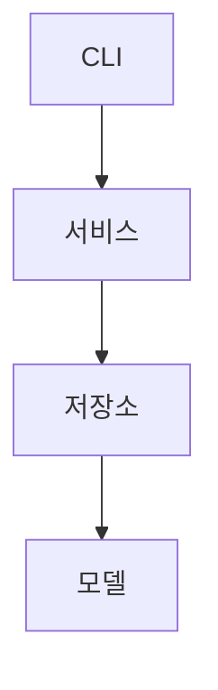

# 파일 기반 가계부 콘솔 프로그램

Python 표준 라이브러리만으로 만드는 콘솔 가계부. 거래를 파일(JSONL)에 영구 저장하고, CRUD·검색·월별 요약·예산·카테고리 관리·CSV 입출력까지 지원한다. 과제 명세의 필수 기능 10가지와 보너스 4가지를 구현했다.

- 바로 써 보려면: [실행 방법](#실행-방법) → [주요 명령 예시](#주요-명령-예시)
- 코드를 이해하려면: [구조](#구조) → [코드 읽는 순서](#코드-읽는-순서) → [공부할 것](#공부할-것)
- 왜 이렇게 만들었는지: [프로젝트 한눈에 보기](#프로젝트-한눈에-보기), [구현하면서 추가로 정한 것](#구현하면서-추가로-정한-것)

## 프로젝트 한눈에 보기

| 항목 | 선택한 방식 | 이유 |
| --- | --- | --- |
| 내부 저장 형식 | JSONL | tags(리스트)·memo(자유 텍스트)에 특수문자가 섞여도 JSON이 이스케이프를 언어 차원에서 처리 — CSV였다면 구분자·RFC4180 이스케이프를 따로 신경 써야 함 |
| 외부 교환 형식 | CSV | import/export는 스펙상 CSV로 고정 → 내부 저장과 역할 분리 |
| 저장 파일 | 거래·카테고리·예산 3개 분리 | 역할이 다른 데이터를 한 파일에 몰아넣지 않음 |
| 계층 구조 | CLI → 서비스 → 저장소 → 모델 (4계층) | project.md 4.14 권장 구조를 따름 |
| 카테고리 초기 정책 | `category add` 선요구 (기본 카테고리 자동 생성 안 함) | 원치 않는 기본 카테고리가 자동으로 안 생기게 |
| `update` 입력 방식 | 옵션 기반 (`--id --amount ...`) | 다른 명령들과 입력 방식 통일 |
| 카테고리 삭제 정책 | 사용 중이면 삭제 차단 | 거래는 남아있는데 카테고리만 사라지는 모순 방지 |

## 실행 방법

Python 3.10 이상만 있으면 된다. 설치할 것은 없다 (표준 라이브러리만 사용).

```bash
cd inner/B2_1                    # budget_app 폴더가 보이는 위치에서 실행한다
python --version                 # 3.10 이상인지 확인
python -m budget_app --help      # 전체 명령 목록
```

맥처럼 `python` 명령이 없는 컴퓨터에서는 `python3` 로 실행한다 (`python3 --version`, `python3 -m budget_app --help`). 이 문서의 예시는 명세 표기대로 `python` 으로 적었다.

형식은 `python -m budget_app <명령> [옵션]` 이다. 처음에는 이 순서로 쓴다.

```bash
python -m budget_app category add              # 1. 카테고리부터 등록 (없으면 add 가 막힌다)
python -m budget_app add                       # 2. 거래 추가 (질문에 차례로 답한다)
python -m budget_app list --limit 5            # 3. 최근 5건 보기
python -m budget_app summary --month 2024-01   # 4. 한 달 요약
```

- 모든 명령(하위 명령 포함)에 `--help` 가 있다. 예: `python -m budget_app budget set --help`
- 옵션은 전부 `--` 로 시작한다. `-h` 같은 짧은 옵션은 만들지 않았다.
- 저장 폴더는 기본 `./data` 이고 `--data-dir 폴더` 로 바꾼다. 명령 앞뒤 어디에 써도 된다.
  `python -m budget_app --data-dir ./mydata list` = `python -m budget_app list --data-dir ./mydata`

입력 방식은 명령마다 하나로 고정했다.

| 방식 | 명령 |
| --- | --- |
| 대화형 (`input()` 으로 하나씩 묻고, 틀리면 다시 묻는다) | `add`, `category add`, `category remove`, `recurring add` |
| 옵션 (`--이름 값`) | `list`, `search`, `summary`, `budget set`, `budget list`, `category list`, `update`, `delete`, `import`, `export`, `backup`, `recurring list/remove/apply` |

`update` 는 옵션 기반으로 고정했다(명세 4.6의 안 A). `update --id <id>` 뒤에 바꿀 항목만 옵션으로 준다.

## 주요 명령 예시

| 명령 | 하는 일 |
| --- | --- |
| `python -m budget_app add` | 거래 추가 (대화형) |
| `python -m budget_app list --limit 3` | 최신순 목록. `--limit` 기본값 10 |
| `python -m budget_app search --from 2024-01-01 --to 2024-01-31 --category food --type expense --q 점심 --tag meal` | 준 조건을 모두 만족하는 거래 (최신순). 조건은 필요한 것만 준다. `--limit N` 도 가능 |
| `python -m budget_app summary --month 2024-01 --top 3` | 월별 요약. `--top` 기본값 3 |
| `python -m budget_app budget set --month 2024-01 --amount 500000` | 월 예산 설정 (같은 달에 다시 하면 금액 변경) |
| `python -m budget_app budget list` | 설정한 예산 목록 |
| `python -m budget_app category add` / `category list` / `category remove` | 카테고리 추가(대화형) / 목록 / 삭제(대화형) |
| `python -m budget_app update --id TX-000004 --amount 18000 --memo "점심 + 커피"` | 준 항목만 수정. `--date --type --category --amount --memo --tags` |
| `python -m budget_app delete --id TX-000002` | 삭제 |
| `python -m budget_app import --from import.csv` | CSV 가져오기 |
| `python -m budget_app export --out export.csv --month 2024-01` | CSV 내보내기. `--month` 또는 `--from`과 `--to` 가 꼭 있어야 한다 |
| `python -m budget_app backup` | (보너스) 저장 파일 전체를 zip 으로 백업 |
| `python -m budget_app recurring add` / `list` / `remove --id RC-000001` / `apply --month 2024-02` | (보너스) 반복 내역 |

아래는 실제로 실행한 화면이다.

### 처음 실행 · category

```text
$ python -m budget_app list
[안내] 저장 파일을 새로 만들었습니다: data (transactions.jsonl, categories.jsonl, budgets.jsonl, recurring.jsonl)
[안내] 거래를 추가하려면 먼저 category add 로 카테고리를 등록하세요.
기록된 거래가 없습니다. add 명령으로 추가하세요.

$ python -m budget_app category add
카테고리명: food
[저장 완료] category=food

$ python -m budget_app category list
- food
- rent
- salary
- transport
```

### add · list · search

```text
$ python -m budget_app add
날짜(YYYY-MM-DD): 2024-01-15
타입(income/expense): expense
카테고리(food, rent, salary, transport): food
금액(양수): 15000
메모(선택): 점심
태그(쉼표로 구분, 없으면 엔터): meal
[저장 완료] id=TX-000004

$ python -m budget_app list --limit 3
ID        | 날짜       | 타입    | 카테고리 | 금액        | 메모      | 태그
----------+------------+---------+----------+-------------+-----------+----------
TX-000005 | 2024-01-20 | expense | food     |    30,000원 | 저녁 회식 | meal,team
TX-000004 | 2024-01-15 | expense | food     |    15,000원 | 점심      | meal
TX-000003 | 2024-01-14 | income  | salary   | 3,000,000원 | 월급      |
(3건)

$ python -m budget_app search --from 2024-01-01 --to 2024-01-31 --category food
ID        | 날짜       | 타입    | 카테고리 | 금액     | 메모      | 태그
----------+------------+---------+----------+----------+-----------+----------
TX-000005 | 2024-01-20 | expense | food     | 30,000원 | 저녁 회식 | meal,team
TX-000004 | 2024-01-15 | expense | food     | 15,000원 | 점심      | meal
(2건)
```

잘못 입력하면 이유와 예시를 보여 주고 같은 질문을 다시 한다.

```text
$ python -m budget_app add
날짜(YYYY-MM-DD): 2024-13-40
[오류] 날짜 형식이 올바르지 않습니다 (YYYY-MM-DD).
[힌트] 예: 2024-01-15
날짜(YYYY-MM-DD):
```

### budget · summary

```text
$ python -m budget_app budget set --month 2024-01 --amount 500000
[저장 완료] 2024-01 예산 500,000원

$ python -m budget_app summary --month 2024-01 --top 3
[2024-01 월별 요약]
총 수입: 3,000,000원
총 지출: 215,000원
잔액: 2,785,000원
예산: 500,000원 (사용률 43.0%)
초과 여부: 초과 아님 (남은 예산 285,000원)

지출 TOP 3
1) rent 150,000원
2) food 45,000원
3) transport 20,000원
```

예산을 넘으면 경고가 나오고, 거래가 없는 달은 "데이터 없음"이라고 알려 준다.

```text
$ python -m budget_app budget set --month 2024-01 --amount 200000
[저장 완료] 2024-01 예산 200,000원

$ python -m budget_app summary --month 2024-01 --top 2
...
예산: 200,000원 (사용률 107.5%)
초과 여부: 초과 - [경고] 예산보다 15,000원 더 썼습니다!

$ python -m budget_app summary --month 2023-05
[2023-05 월별 요약]
데이터 없음: 이 달에 기록된 거래가 없습니다.
예산: 미설정 (설정: budget set --month 2023-05 --amount 금액)
```

### update · delete · 오류와 종료 코드

```text
$ python -m budget_app update --id TX-000004 --amount 18000 --memo "점심 + 커피"
[수정 완료] id=TX-000004
ID        | 날짜       | 타입    | 카테고리 | 금액     | 메모        | 태그
----------+------------+---------+----------+----------+-------------+-----
TX-000004 | 2024-01-15 | expense | food     | 18,000원 | 점심 + 커피 | meal

$ python -m budget_app delete --id TX-000002
[삭제 완료] id=TX-000002
...

$ python -m budget_app delete --id TX-000099
[오류] 없는 데이터입니다: id 가 TX-000099 인 거래를 찾을 수 없습니다.
[힌트] list 또는 search 명령으로 id 를 확인하세요.
$ echo $?
1

$ python -m budget_app category remove
삭제할 카테고리명: food
[오류] 사용 중인 카테고리는 삭제할 수 없습니다: food (거래 3건, 반복 규칙 0건)
[힌트] search --category food 로 찾아 update 로 카테고리를 바꾸거나 delete 한 뒤 다시 시도하세요.
```

### export · import

```text
$ python -m budget_app export --out export.csv --month 2024-01
[완료] export.csv (4 records)

$ python -m budget_app import --from import.csv
[완료] imported=1, skipped=2
  - 3번째 줄 건너뜀: 날짜 형식이 올바르지 않습니다 (YYYY-MM-DD).
  - 4번째 줄 건너뜀: 등록되지 않은 카테고리입니다: cafe
[안내] 건너뛴 줄만 고쳐서 새 CSV 로 다시 import 하세요.
       (같은 파일을 그대로 다시 넣으면 이미 들어간 거래가 중복됩니다)
```

### 보너스: backup · recurring

```text
$ python -m budget_app backup
[백업 완료] data/backups/backup-20260930-164408.zip

$ python -m budget_app recurring add
매월 며칠(1~31): 31
타입(income/expense): expense
카테고리(food, rent, salary, transport): rent
금액(양수): 500000
메모(선택): 월세
태그(쉼표로 구분, 없으면 엔터): fixed
[저장 완료] id=RC-000001

$ python -m budget_app recurring apply --month 2024-02
[완료] 2024-02 반복 내역 1건 생성
ID        | 날짜       | 타입    | 카테고리 | 금액      | 메모 | 태그
----------+------------+---------+----------+-----------+------+------
TX-000007 | 2024-02-29 | expense | rent     | 500,000원 | 월세 | fixed
(1건)

$ python -m budget_app recurring apply --month 2024-02
[완료] 2024-02 반복 내역 0건 생성
새로 만들 것이 없습니다. (규칙이 없거나, 이 달은 이미 만들었습니다)
```

31일 규칙은 2월에는 말일로 맞춘다. 같은 달에 `apply` 를 다시 실행해도 중복으로 만들지 않는다. 백업을 되돌리려면 zip 을 풀어 `data` 폴더에 덮어쓴다.

## 저장 파일 위치와 형식

위치는 명령을 실행한 폴더의 `./data` 이다 (`--data-dir` 로 변경). 없으면 처음 실행할 때 자동으로 만들고 `[안내]` 를 출력한다.

| 파일 | 내용 | 한 줄의 모양 |
| --- | --- | --- |
| `data/transactions.jsonl` | 거래 | `{"id": "TX-000004", "type": "expense", "date": "2024-01-15", "amount": 18000, "category": "food", "memo": "점심 + 커피", "tags": ["meal"]}` |
| `data/categories.jsonl` | 카테고리 | `{"name": "food"}` |
| `data/budgets.jsonl` | 월 예산 | `{"month": "2024-01", "amount": 200000}` |
| `data/recurring.jsonl` | (보너스) 반복 규칙 | `{"id": "RC-000001", "day": 31, "type": "expense", "category": "rent", "amount": 500000, "memo": "월세", "tags": ["fixed"], "applied_months": ["2024-02"]}` |
| `data/app.log` | 실행 기록 (데이터 아님) | `2026-09-30 16:44:08,067 INFO [backup] 시작` |
| `data/backups/backup-날짜-시각.zip` | (보너스) 백업 | 위 jsonl 4개를 묶은 zip |

- 형식은 JSONL 이다. 한 줄이 JSON 객체 하나이고, 인코딩은 UTF-8 이다. 한글은 그대로 저장되어 편집기로 열어도 읽힌다.
- 추가는 파일 끝에 한 줄을 덧붙인다. 수정·삭제는 임시 파일(`transactions.jsonl.tmp`)에 새 내용을 전부 쓴 뒤 원본과 바꿔치기한다. 도중에 꺼져도 원본이 남는다.
- 카테고리 파일이 비어 있으면 `add` 를 막고 `category add` 를 먼저 하라고 안내한다 (명세 4.3의 안 B). 기본 카테고리를 자동으로 만들지 않는다.
- 카테고리 이름은 소문자로 통일한다 (`Food` = `food`). 금액은 원 단위 양의 정수이고 `15,000` 처럼 쉼표를 넣어도 된다.
- 파일을 손으로 고치다 한 줄이 깨지면, 그 줄을 건너뛰지 않고 `[오류] transactions.jsonl 파일이 손상되었습니다 (8번째 줄).` 로 멈춘다. 건너뛰면 합계가 조용히 틀리고, 수정·삭제 때 그 줄이 사라지기 때문이다.

## import/export CSV 스키마

| column | required | 설명 |
| --- | --- | --- |
| date | Y | YYYY-MM-DD |
| type | Y | income / expense |
| category | Y | 등록된 카테고리 |
| amount | Y | 양수 정수 |
| memo | N | 문자열 |
| tags | N | 쉼표(,) 구분 문자열 |

공통: UTF-8, 헤더 포함. 첫 줄은 `date,type,category,amount,memo,tags` 이다.

```csv
date,type,category,amount,memo,tags
2024-01-05,expense,rent,150000,월세,"home,fixed"
2024-01-14,income,salary,3000000,월급,
2024-01-15,expense,food,18000,점심 + 커피,meal
```

export

- `--month YYYY-MM` 또는 `--from YYYY-MM-DD --to YYYY-MM-DD` 중 하나 이상이 꼭 있어야 한다. 없으면 오류로 끝난다. 둘 다 주면 둘 다 만족하는 거래만 나온다.
- 위 6개 컬럼을 이 순서로 쓴다. id 는 내보내지 않는다. 태그가 여러 개면 `"home,fixed"` 처럼 따옴표로 감싼다.
- 파일 이름은 `.csv` 로 끝나야 한다. 실수로 `data/transactions.jsonl` 을 덮어쓰는 일을 막기 위해서다.
- 순서는 등록한 순서(파일에 적힌 순서)이다. 조건에 맞는 거래가 없으면 헤더만 있는 파일이 만들어진다.

import

- 헤더에 `date,type,category,amount` 가 없으면 아무것도 가져오지 않고 오류로 끝난다. `memo`, `tags` 컬럼은 없어도 된다. 다른 컬럼은 무시한다.
- 행마다 검증해서 맞는 행만 저장하고, 틀린 행은 건너뛴 뒤 몇 번째 줄이 왜 틀렸는지 알려 준다 (부분 성공 + 보고). 헤더가 1번째 줄이다.
- 검증을 끝까지 마친 뒤에 한꺼번에 저장한다. 그래서 파일을 읽다가 실패하면(UTF-8 이 아님 등) 한 건도 들어가지 않는다.
- id 는 새로 붙인다. CSV 에 id 가 없어 중복을 구분할 수 없으므로, 같은 파일을 두 번 import 하면 두 번 들어간다.
- 엑셀에서 저장할 때는 'CSV UTF-8(쉼표로 분리)' 을 고른다. 그냥 'CSV' 는 UTF-8 이 아니라서 거부된다.

## 구조

CLI → 서비스 → 저장소 → 모델 순으로 의존한다 (아래는 위를 모름). 서비스/저장소/모델은 각각 거래·카테고리·예산 3개씩 있음. (보너스인 반복 내역까지 치면 4개씩)



| 계층 | 파일 | 책임 | 하지 않는 일 |
| --- | --- | --- | --- |
| CLI | [budget_app/cli.py](budget_app/cli.py) | 명령줄 해석(argparse), 입력 받기(`input`), 서비스 호출, 출력 | 규칙 판단, 파일 접근 |
| 서비스 | [budget_app/services.py](budget_app/services.py) | 업무 규칙: 등록된 카테고리만 허용, 최신순, 사용 중 카테고리 삭제 차단, export 기간 조건, 요약 계산 | `print`/`input`, JSON·CSV 문법 |
| 저장소 | [budget_app/storage.py](budget_app/storage.py) | 파일 읽기/쓰기: 제너레이터로 읽기, 끝에 추가, 원자적 교체, CSV, 백업 | 규칙 판단 |
| 모델 | [budget_app/models.py](budget_app/models.py) | 데이터 모양(dataclass)과 값 검증(`parse_*`) | 파일, 화면 |

여러 계층이 함께 쓰는 도구가 3개 있다.

| 파일 | 내용 |
| --- | --- |
| [budget_app/errors.py](budget_app/errors.py) | 원인(`message`)과 해결 힌트(`hint`)를 함께 담는 예외 `AppError`, `ValidationError`, `NotFoundError` |
| [budget_app/decorators.py](budget_app/decorators.py) | 데코레이터 3개: `handle_errors`(오류 → 메시지 + 종료 코드), `log_command`(실행 기록), `measure_time`(실행 시간) |
| [budget_app/formatter.py](budget_app/formatter.py) | 화면에 찍을 문자열 만들기: 표 정렬, 금액, 요약, `[오류]/[힌트]` |

서비스끼리는 서로를 부르지 않는다. 다른 데이터가 필요하면 그 데이터의 저장소를 직접 받는다. 어떤 서비스가 어떤 파일을 읽고 쓰는지는 `services.py` 맨 아래 `Ledger` 한 곳에서 정한다.

| 서비스 | 쓰는 파일 | 읽기만 하는 파일 |
| --- | --- | --- |
| `TransactionService` | transactions | categories (등록된 카테고리인지) |
| `CategoryService` | categories | transactions, recurring (사용 중인지) |
| `BudgetService` | budgets | transactions (요약 계산) |
| `RecurringService` | recurring, transactions | categories |

명령 하나가 지나가는 길 (`python -m budget_app list --limit 3`)

1. `__main__.py` 가 `cli.main()` 을 부르고, 그 반환값을 종료 코드로 쓴다.
2. `cli.main` — argparse 가 `list --limit 3` 을 해석해 `args.handler = cmd_list`, `args.limit = "3"` 을 만든다. `Ledger(data)` 로 저장소와 서비스를 조립하고 저장 파일이 없으면 만든다.
3. `cli.cmd_list` — `parse_count("3")` 로 3 을 검증하고 `ledger.transactions.list_recent(3)` 을 부른다. (`@log_command` 가 시작/성공을 app.log 에 적는다)
4. `services.list_recent` — `newest_first(저장소.stream(), 3)`. (`@measure_time` 이 걸린 시간을 적는다)
5. `storage.stream` — 파일을 한 줄 읽어 `Transaction` 으로 바꿔 `yield`. `heapq.nlargest` 가 하나 받을 때마다 "지금까지 중 최신 3건"만 남긴다.
6. `cli.cmd_list` — 받은 3건을 `formatter.format_transactions` 로 표로 만들어 `print`.
7. 도중에 예외가 나면 `main` 에 붙은 `@handle_errors` 가 `[오류]/[힌트]` 를 출력하고 1 을 반환한다.

## 코드 읽는 순서

아래에서 위로(모델 → CLI) 읽으면 모르는 것이 앞에 나오지 않는다. 파일마다 맨 위 설명글(docstring)에 그 파일이 하는 일과 하지 않는 일을 적어 두었다.

| 순서 | 파일 | 줄 수 | 여기서 볼 것 |
| --- | --- | --- | --- |
| 1 | [errors.py](budget_app/errors.py) | 28 | 예외 3개. 전부 `message` + `hint` 를 가진다 |
| 2 | [models.py](budget_app/models.py) | 336 | `parse_*` 검증 함수 → dataclass 4개(`__post_init__` 에서 스스로 검증) → `SearchFilter.matches` |
| 3 | [storage.py](budget_app/storage.py) | 269 | `JsonlRepository.stream`(제너레이터) → `append` → `upsert`/`remove` → `_rewrite`(원자적 교체) |
| 4 | [formatter.py](budget_app/formatter.py) | 116 | `display_width`(한글 2칸) → `render_table` |
| 5 | [decorators.py](budget_app/decorators.py) | 126 | `handle_errors` → `log_command` → `measure_time` |
| 6 | [services.py](budget_app/services.py) | 494 | `newest_first` → `TransactionService` → `CategoryService.remove` → `BudgetService.summarize` → `Ledger` |
| 7 | [cli.py](budget_app/cli.py) | 504 | 맨 아래 `main` → `build_parser` → `cmd_add`, `cmd_list` 부터 |
| 8 | [__main__.py](budget_app/__main__.py) | 11 | `python -m budget_app` 이 실행하는 파일 |

`recurring`(반복 내역)과 `backup` 은 보너스라서 처음 읽을 때는 건너뛰어도 된다. `RecurringRule`, `RecurringRepository`, `RecurringService`, `cmd_recurring_*`, `cmd_backup`, `create_backup` 이 해당한다.

## 공부할 것

동료 평가에서 직접 설명해야 하는 것부터 적었다. ★ 는 과제 목표(명세 3장)에 있는 것이다. 항목마다 볼 곳, 직접 해 보기, 스스로 답해 볼 질문이 있다. 질문의 답은 [docs/peer-review.md](docs/peer-review.md) 에 있다.

### 1. ★ 제너레이터와 스트리밍

`yield` 가 있는 함수는 호출해도 바로 실행되지 않는다. `for` 나 `next` 가 값을 달라고 할 때마다 다음 `yield` 까지만 실행하고 멈춘다. 그래서 파일이 아무리 커도 한 줄씩만 메모리에 올라온다.

- 볼 곳: `storage.py` 의 `JsonlRepository.stream` → `services.py` 의 `newest_first`, `TransactionService.matching`, `BudgetService.summarize` → `storage.py` 의 `write_transactions_csv`
- 해 보기 1: 제너레이터는 달라고 할 때만 읽는다. (거래가 2건 이상 있는 상태에서)

  ```bash
  python -c "
  from pathlib import Path
  from budget_app.storage import TransactionRepository
  g = TransactionRepository(Path('data/transactions.jsonl')).stream()
  print(g)         # <generator object ...> 아직 파일을 열지도 않았다
  print(next(g))   # 첫 줄만 읽었다
  print(next(g))   # 둘째 줄만 읽었다
  "
  ```

- 해 보기 2: 10만 건으로 메모리를 잰다. 전부 list 로 읽으면 55MB, `list --limit 10` 은 0.05MB 가 나온다.

  ```bash
  python tests/benchmark.py --records 100000
  ```

- 질문
  - list 는 최신순인데, 전부 메모리에 올리지 않고 어떻게 정렬하나?
  - search 에 `--limit` 을 주지 않으면 왜 메모리를 더 쓰나?
  - `measure_time` 을 `stream` 에 직접 붙이면 왜 0ms 에 가깝게 나오나?
  - `find` 는 찾는 순간 읽기를 멈춘다. 어느 코드가 그렇게 만드나?

### 2. ★ 데코레이터

함수를 받아서, 앞뒤에 일을 덧붙인 새 함수를 돌려주는 함수다. `@log_command` 를 함수 위에 쓰는 것은 `cmd_list = log_command(cmd_list)` 와 같다.

- 볼 곳: `decorators.py` 의 3개 → 붙인 곳은 `cli.py` 의 `main`(`@handle_errors`), `cmd_*` 18개(`@log_command`), `services.py` 의 5개 메서드(`@measure_time`)
- 해 보기 1: 명령을 몇 개 실행하고 `tail data/app.log` 로 기록을 본다.
- 해 보기 2: `cli.py` 에서 `cmd_list` 위의 `@log_command` 한 줄을 지우고 `list` 를 실행한 뒤 app.log 를 다시 본다. `[list]` 기록만 사라지고 동작은 그대로다. (확인 후 되돌린다)
- 해 보기 3: `python -c "from budget_app.cli import cmd_list; print(cmd_list.__name__)"` → `cmd_list`. `decorators.py` 에서 `@functools.wraps(func)` 를 지우면 `wrapper` 가 나온다.
- 질문
  - 데코레이터가 없다면 18개 명령 함수는 어떤 모습이 되나?
  - `handle_errors` 는 왜 명령 함수마다가 아니라 `main` 에 한 번만 붙였나?
  - `wrapper(*args, **kwargs)` 는 왜 이렇게 받나?
  - `log_command` 는 예외를 잡은 뒤 왜 다시 `raise` 하나?

### 3. ★ 타입 힌트

실행 결과는 바꾸지 않는다. 함수가 무엇을 받고 무엇을 돌려주는지 약속을 코드에 적어 두는 것이고, 편집기(VS Code 의 Pylance)나 검사기(mypy)가 약속을 어긴 코드를 실행하기 전에 찾아 준다.

- 볼 곳 (설명할 때 쓸 실제 예)
  - `storage.py` 의 `find(...) -> T | None` : 못 찾으면 None 이라는 약속. 그래서 `services.py` 의 `get` 에 `if tx is None:` 검사가 있다
  - `models.py` 의 `TransactionType = Literal["income", "expense"]` : 아무 문자열이 아니라 두 값 중 하나라는 약속. `parse_type` 의 반환 타입이다
  - `storage.py` 의 `class JsonlRepository(Generic[T])` 와 `stream(...) -> Iterator[T]` : `TransactionRepository` 의 `stream` 은 `Transaction` 을 준다는 약속
  - `decorators.py` 의 `ParamSpec` : 데코레이터를 붙여도 원래 함수의 매개변수·반환 타입이 그대로라는 약속
  - `cli.py` 의 `ask(prompt, parse: Callable[[str], T]) -> T` : `parse_amount` 를 넘기면 `int`, `parse_date` 를 넘기면 `str` 이 나온다
- 해 보기 1: 검사기 mypy 로 프로그램 전체를 검사한다. 가장 엄격한 `--strict` 에서도 문제가 없다.

  ```bash
  uvx mypy budget_app --strict       # Success: no issues found in 9 source files
  ```

- 해 보기 2: 약속을 일부러 어긴 코드를 모아 둔 [docs/type_demo.py](docs/type_demo.py) 를 검사한다. 실행하지 않고 읽기만 해서 다섯 군데를 찾아낸다.

  ```bash
  uvx mypy docs/type_demo.py
  ```

  ```text
  docs/type_demo.py:29: error: Item "None" of "Transaction | None" has no attribute "amount"  [union-attr]
  docs/type_demo.py:32: error: Argument "type" to "Transaction" has incompatible type "Literal['spend']"; expected "Literal['income', 'expense']"  [arg-type]
  docs/type_demo.py:36: note: Revealed type is "def (limit: int) -> list[budget_app.models.Transaction]"
  docs/type_demo.py:37: error: Argument 1 to "list_recent" of "TransactionService" has incompatible type "str"; expected "int"  [arg-type]
  docs/type_demo.py:40: note: Revealed type is "int"
  docs/type_demo.py:41: note: Revealed type is "str"
  docs/type_demo.py:42: note: Revealed type is "Literal['income'] | Literal['expense']"
  docs/type_demo.py:45: error: Argument 4 to "add" of "TransactionService" has incompatible type "str"; expected "int"  [arg-type]
  docs/type_demo.py:50: note: Revealed type is "budget_app.models.Transaction"
  docs/type_demo.py:51: error: "Transaction" has no attribute "amout"; maybe "amount"?  [attr-defined]
  Found 5 errors in 1 file (checked 1 source file)
  ```

- 해 보기 3: `services.py` 의 `get` 에서 `if tx is None:` 부터 `raise` 끝까지를 주석으로 막고 `uvx mypy budget_app` 을 돌리면 `Incompatible return value type (got "Transaction | None", expected "Transaction")` 가 나온다. (확인 후 되돌린다)
- mypy 는 개발할 때 쓰는 도구라서 프로그램의 '표준 라이브러리만' 제약과는 무관하다. `uvx` 가 없는 컴퓨터에서는 `pip install mypy` 뒤에 `mypy budget_app --strict` 로 실행한다.
- 질문
  - 타입 힌트는 실행 중에 검사되나? 아니라면 잘못된 값은 어디서 막나? (`__post_init__`)
  - `list[str]`, `str | None`, `Iterator[Transaction]` 은 각각 무슨 뜻인가?

### 4. ★ 계층과 책임

- 볼 곳: 각 파일 맨 위 설명글, `services.py` 맨 아래 `Ledger`, 이 문서의 [구조](#구조)
- 해 보기: `python -m unittest tests.test_spec_static -v`. import 방향, "input 은 cli 에만", "파일 열기는 storage 에만"을 소스에서 직접 세어 확인한다.
- 질문
  - "등록되지 않은 카테고리는 거부한다"는 어느 계층에 있고, 왜 거기인가?
  - 저장 형식을 JSONL 에서 SQLite 로 바꾼다면 어느 파일을 고치나? 화면을 웹으로 바꾼다면?
  - `CategoryService` 는 왜 거래 저장소를 받나? 서비스끼리 부르게 하지 않은 이유는?

### 5. ★ 파일 저장과 안전한 수정/삭제

- 볼 곳: `storage.py` 의 `append`, `upsert`, `remove`, `_rewrite`, `_last_line_is_cut`
- 해 보기: `python -m unittest tests.test_storage.SafeWriteTests -v`. 쓰다가 실패하는 상황을 일부러 만들어 원본이 그대로인지 확인한다.
- 질문
  - 파일 가운데 한 줄만 고칠 수 없는 이유는?
  - 임시 파일에 쓰고 `os.replace` 로 바꾸면 무엇이 안전해지나? 원본에 바로 덮어쓰면 어떤 순간이 위험한가?
  - `flush` 와 `os.fsync` 는 각각 무엇을 하나?
  - JSONL 과 CSV 의 장단점은? 왜 내부는 JSONL, 외부는 CSV 인가?

### 6. 예외 처리와 종료 코드

- 볼 곳: `errors.py`, `decorators.py` 의 `handle_errors`, `cli.py` 의 `ask`, `Parser.error`, `__main__.py`
- 해 보기

  ```bash
  python -m budget_app delete --id TX-999999; echo "종료 코드: $?"    # 1
  python -m budget_app list; echo "종료 코드: $?"                      # 0
  python -m budget_app delete --id TX-999999 2>/dev/null               # 아무것도 안 보인다: 오류는 stderr 로 나간다
  ```

- 질문
  - 스택트레이스는 왜 화면에 찍지 않고, 어디에 남기나?
  - `ValidationError` 가 대화형 입력과 옵션 입력에서 다르게 처리되는 곳은?
  - 종료 코드 0, 1, 2, 130 은 각각 언제 나오나?

### 7. dataclass 와 검증

- 볼 곳: `models.py` 의 `Transaction`, `__post_init__`, `field(default_factory=list)`
- 질문
  - `tags: list[str] = []` 라고 쓰면 왜 안 되나?
  - 파일에서 읽을 때도 `__post_init__` 검증을 거치게 한 이유는?

### 8. argparse

- 볼 곳: `cli.py` 의 `Parser`, `add_command`, `build_parser`
- 질문
  - `args.handler` 는 어디서 정해지고 어디서 쓰이나?
  - `--from` 은 왜 `dest="date_from"` 으로 받나? (`from` 은 파이썬 예약어)
  - 옵션 값을 argparse 의 `type=int` 로 받지 않고 문자열로 받아 `parse_count` 로 검사한 이유는?

### 그 밖에 코드에 나오는 것

`pathlib.Path`, `json.dumps/loads`, `csv.DictReader/writer`, `logging`, `heapq.nlargest`, `collections.defaultdict`, `unicodedata.east_asian_width`, `zipfile`, `python -m` 과 `__main__.py`. 테스트에는 `unittest`, `subprocess`, `tracemalloc`, `ast` 가 나온다.

## 구현하면서 추가로 정한 것

[프로젝트 한눈에 보기](#프로젝트-한눈에-보기)의 7가지는 설계 단계에서 정한 것이고, 아래는 구현하면서 정한 것이다. 바꾸고 싶으면 '바꿀 곳'을 고치면 된다.

| 항목 | 선택한 방식 | 이유 | 바꿀 곳 |
| --- | --- | --- | --- |
| 서비스 사이의 연결 (설계 때 미정이던 것) | 서비스는 서로를 부르지 않고, 필요한 저장소를 직접 받는다. 조립은 `Ledger` 한 곳 | 거래 서비스는 카테고리가, 카테고리 서비스는 거래가 필요해서 서로 부르면 맞물린다. 조합 계층을 따로 두기에는 해당되는 곳이 두 군데뿐 | `services.py` 의 `Ledger` |
| `summary` 의 위치 | `BudgetService.summarize` | 거래와 예산을 둘 다 읽어야 하고, 결과의 핵심이 예산 대비 사용률 | `services.py` |
| 최신순의 뜻 | 날짜가 늦은 것 먼저, 같은 날이면 나중에 등록한 것(id 번호가 큰 것) 먼저 | 지난 날짜의 거래를 나중에 입력해도 날짜 순서로 보여야 가계부답다 | `services.py` 의 `newest_first` |
| 기본값 | `list --limit` 10, `summary --top` 3 | 한 화면에 들어오는 양, 명세 예시가 `--top 3` | `cli.py` 의 `DEFAULT_LIMIT`, `DEFAULT_TOP` |
| id | `TX-000001` 부터 '가장 큰 번호 + 1'. `tx-12` 처럼 줄여 써도 `TX-000012` 로 맞춘다 | 짧아서 `delete --id` 에 치기 쉽고 등록 순서를 알 수 있다 | `models.py` 의 `make_id`, `parse_id` |
| 대화형 명령 | `add`, `category add`, `category remove`, `recurring add` | 명세의 기본이 대화형이고, 옵션이 허용된 명령 목록에 이 넷은 없다 | `cli.py` |
| 카테고리 이름 | 소문자로 통일 | `Food` 와 `food` 가 따로 생기지 않게 | `models.py` 의 `parse_category_name` |
| import 정책 | 부분 성공 + 건너뛴 줄 보고. 검증을 끝낸 뒤 한꺼번에 저장. 종료 코드는 0 | 명세 예시가 `imported=5, skipped=0` 형태. 한 줄 때문에 전체를 거부하면 불편하고, 말없이 건너뛰면 신뢰를 잃는다 | `services.py` 의 `import_csv` |
| export 순서와 파일 이름 | 등록 순서 그대로, `.csv` 만 허용 | 정렬이 없으면 끝까지 한 건씩 흘려보낼 수 있다. `.csv` 제한은 저장 파일 덮어쓰기 방지 | `services.py` 의 `export_csv` |
| 손상된 줄 | 건너뛰지 않고 오류로 멈춘다 | 건너뛰면 합계가 조용히 틀리고, 다시 쓸 때 그 줄이 사라진다 | `storage.py` 의 `stream` |
| 오류 출력 | `[오류] 원인` + `[힌트] 해결 방법` 을 stderr 로. 명령 형식 오류(argparse)도 같은 모양 | 명세 4.13. 정상 출력과 섞이지 않게 | `formatter.py` 의 `print_error`, `cli.py` 의 `Parser.error` |
| 옵션 값 검사 | argparse 는 전부 문자열로 받고, 검사는 `models.py` 의 `parse_*` 가 한다 | 대화형·옵션·CSV 가 같은 검증 함수를 쓰고, 오류 문구가 항상 같은 모양 | `cli.py` 의 `build_parser` |
| 실행 기록 | `data/app.log` 에만 남기고 화면에는 찍지 않는다 | 스택트레이스 출력 금지. 자세한 내용은 파일로 | `decorators.py` 의 `setup_logging` |
| 보너스 | 4개 모두 구현 (backup, recurring, 표 정렬, 원자적 교체) | 아래 계층에 이미 준비되어 있었다 | — |

## 오류 처리와 종료 코드

| 종료 코드 | 언제 | 예 |
| --- | --- | --- |
| 0 | 정상 | `list`, `summary` 의 "데이터 없음", import 에서 일부 줄을 건너뛴 경우 |
| 1 | 오류 | 없는 id, 잘못된 값, 사용 중인 카테고리 삭제, 없는 CSV, 손상된 저장 파일, 쓰기 권한 없음 |
| 2 | 명령 형식 오류 | 없는 명령, 빠진 필수 옵션, 없는 옵션 |
| 130 | 중단 | 입력 도중 Ctrl+C 또는 Ctrl+D. 아무것도 저장하지 않는다 |

- 오류는 항상 `[오류] 원인` 과 `[힌트] 해결 방법` 두 줄로, stderr 에 나온다. 스택트레이스는 화면에 찍지 않는다.
- 예상하지 못한 오류(버그)는 화면에 "예상하지 못한 오류가 발생했습니다" 만 보여 주고, 자세한 내용은 `data/app.log` 에 남긴다.
- 대화형 입력에서 값이 틀리면 종료하지 않고 같은 질문을 다시 한다.
- 확인: `python -m budget_app delete --id TX-999999; echo $?`

## 테스트와 검증

```bash
python -m unittest discover -s tests                        # 전체 205개 (약 15초)
python -m unittest discover -s tests -v                     # 테스트마다 명세 조항 번호와 설명을 함께 출력
python -m unittest tests.test_cli -v                        # 파일 하나만
python -m unittest tests.test_storage.SafeWriteTests -v     # 클래스 하나만
```

테스트도 표준 라이브러리(`unittest`)만 쓴다. 테스트 설명 앞의 `[4.5]` 같은 표기는 명세 조항 번호다.

확인한 것 (2026-09-30)

- Python 3.10.20, 3.11.16, 3.14.7 에서 205개 전부 통과. 경고도 오류로 취급해서 실행했다 (`-W error -X dev`).
- 타입 검사: `uvx mypy budget_app --strict` (mypy 2.3.1) → `Success: no issues found in 9 source files`.
- 코드를 일부러 36군데 망가뜨려 봤을 때 테스트가 잡는지: 3.11 에서 36개 전부, 3.10 에서 35개.
- README 와 docs 에 적은 명령과 출력은 빈 폴더에서 실제로 실행한 것이다.

확인하지 못한 것

- Windows 에서의 실행. macOS 에서만 돌렸다.

| 파일 | 확인하는 것 |
| --- | --- |
| [tests/test_cli.py](tests/test_cli.py) | 진짜 프로그램을 새 프로세스로 실행해 화면 출력·종료 코드·저장 파일을 본다. 동료가 확인하는 방식과 같다 |
| [tests/test_services.py](tests/test_services.py) | 업무 규칙 |
| [tests/test_storage.py](tests/test_storage.py) | 제너레이터, 원자적 교체(쓰다가 실패해도 원본 유지), 손상된 파일, CSV, 백업 |
| [tests/test_models.py](tests/test_models.py) | 값 검증 |
| [tests/test_decorators.py](tests/test_decorators.py) | 데코레이터 3개 |
| [tests/test_streaming.py](tests/test_streaming.py) | 2만 건 파일에서 기능별 최대 메모리를 재서 "전체를 올리지 않는다"를 확인 |
| [tests/test_spec_static.py](tests/test_spec_static.py) | 소스 구조: 표준 라이브러리만, import 방향, 옵션은 `--` 만, 데코레이터 적용, 타입 힌트, 이 README 의 필수 항목 |
| [tests/benchmark.py](tests/benchmark.py) | 테스트가 아니라 측정 도구. 10만 건에서 기능별 시간과 메모리 |

조항별로 어디에 구현했고 어떤 테스트로 확인했는지는 [docs/requirements-traceability.md](docs/requirements-traceability.md) 에 있다.

## 알려진 한계

- 모든 조회가 파일을 처음부터 끝까지 읽는다. 10만 건(13.7MB)에서 `list` 약 0.36초, `update`/`delete` 약 1.3초(파일 전체를 다시 쓴다). 인덱스가 없어서다.
- `add` 는 새 id 를 만들려고 파일 전체를 읽는다. 마지막 번호를 따로 저장하면 없앨 수 있다.
- 가장 최근 거래를 지운 뒤 추가하면 그 id 가 다시 쓰인다 (가장 큰 번호 + 1 이라서).
- `search` 에 `--limit` 을 주지 않으면 정렬하려고 조건에 맞은 거래를 모두 메모리에 모은다. 파일 전체는 아니다.
- 두 터미널에서 동시에 쓰는 경우를 막는 잠금이 없다.
- `recurring apply` 는 파일 두 개(거래, 규칙)를 차례로 쓴다. 그 사이에 꺼지면 다음 `apply` 에서 그 달 거래가 한 번 더 만들어질 수 있다.
- 명령 형식 오류의 원인 부분은 argparse 의 영어 문구가 그대로 나온다. 예: `the following arguments are required: --id`

## 진행 상황

구현과 검증이 끝났다 (2026-09-30). 필수 기능 10가지와 보너스 4가지가 동작하고, 명세 조항별 확인 결과는 [docs/requirements-traceability.md](docs/requirements-traceability.md) 에 있다.

평가 때 띄워 놓고 설명할 흐름 그림을 더했다 (2026-10-18). 글 버전은 [docs/workflows.md](docs/workflows.md), 단계별로 재생하는 화면은 [docs/flow-explorer/](docs/flow-explorer/README.md) 이다. B7-1 의 흐름 탐색기와 같은 틀이고, 그림 속 색은 계층(CLI · 서비스 · 저장소 · 모델 · 공통 도구)이다. 화면 출력은 실제로 실행해 나온 것이고, 만들면서 정한 것은 탐색기 README 의 '결정 기록'에 있다. 프로그램 코드는 바꾸지 않았다.

## 문서

- [docs/requirements-traceability.md](docs/requirements-traceability.md) — 명세 조항 → 구현 위치 → 확인 방법
- [docs/peer-review.md](docs/peer-review.md) — 동료 평가 질문별 답변, 시연 방법, 코드 위치
- [docs/workflows.md](docs/workflows.md) — 흐름 그림 21개(Mermaid). 평가 질문 → 그림 대응표가 맨 위에 있다
- [docs/flow-explorer/](docs/flow-explorer/README.md) — 같은 흐름을 단계별로 재생하는 화면. `docs/flow-explorer/index.html` 을 더블클릭해서 연다 (인터넷 없이 동작)
- [docs/archify/](docs/archify/README.md) — archify 로 그린 한 장짜리 그림 6개(계층 구조 · 클래스 둘 · list 호출 순서 · update 원자적 교체 · import 두 단계). `docs/archify/index.html` 에서 목록을 연다
- [docs/type_demo.py](docs/type_demo.py) — 타입 힌트가 잡아 주는 것을 검사기로 직접 보는 파일 (실행용이 아님)
- [docs/sample-import.csv](docs/sample-import.csv) — 시연용 CSV (정상 6줄 + 일부러 틀린 2줄)
