# B2-1 가계부 흐름 그림 — 평가 때 띄워 놓고 설명하기

평가 때 화면에 띄워 놓고 손가락으로 따라가며 설명하는 그림 모음입니다. 말할 문장과 시연 명령은 [peer-review.md](peer-review.md)에 있고, 여기는 **흐름을 그림으로** 보여 주는 쪽입니다.
같은 흐름을 단계별로 **재생**하는 화면(움직임 · 시나리오 전환 · 코드 바로 열기)은 [flow-explorer/](flow-explorer/README.md) — `flow-explorer/index.html` 을 열면 됩니다.

- 기준 코드: 이 폴더의 `budget_app/` (2026-10-18 대조). 함수 이름 · 줄 번호 · 숫자는 이 코드와 맞췄습니다.
- 화면 출력은 2026-10-18 에 빈 저장 폴더에서 실제로 실행해 나온 것입니다. 저장 폴더 경로만 `data` 로 줄였습니다.
- 그림은 Mermaid 입니다. GitHub 와 VS Code(Markdown Preview Enhanced)의 미리보기에서 그림으로 보입니다.
- 색은 계층입니다. 🩷 CLI(`cli.py`) · 🟩 서비스(`services.py`) · 🟦 저장소(`storage.py`) · 🟨 모델(`models.py`) · 🩵 공통 도구(`errors.py` · `decorators.py` · `formatter.py`) · ⬜ 파일

## 0. 질문이 오면 어느 그림?

동료 평가 질문 16문항(번호는 [peer-review.md](peer-review.md))과 명세 3장 "과제 목표"(★)를 그림에 이었습니다.

| 이런 질문이 오면 | 문항 | 그림 |
|---|---|---|
| "전체 구조 · 모듈 책임을 설명해 주세요" ★ | 2-1 | [1](#1-전체-구조--네-계층과-공통-도구) |
| "클래스 책임 경계는요? 서비스끼리는 어떻게 이어져요?" ★ | 2-2 | [2](#2-ledger-조립--서비스는-저장소를-받는다) |
| "명령 하나가 실행되면 무슨 일이 일어나요? 종료 코드는요?" | 1-2 · 1-7 | [3](#3-명령-한-번의-일생) |
| "add 는 어떻게 입력받아요? 틀리게 넣으면요?" | 1-1 · 1-6 | [4](#4-add--대화형-입력과-다시-묻기) |
| "list · search 를 제너레이터로 어떻게 했어요?" ★ | 3-1 | [5](#5-list--search--읽기--거르기--고르기) · [6](#6-제너레이터가-한-줄씩-흐르는-모습) |
| "검색 조건은 어떻게 검사해요?" | 1-1 | [7](#7-search-조건-검사--searchfiltermatches) |
| "예산 사용률 · 초과 경고는요?" | 1-4 | [8](#8-summary--budget) |
| "update · delete 는요? 없는 id 는요?" | 1-1 | [9](#9-update--delete) |
| "파일 기반 수정 · 삭제를 어떻게 안전하게 했어요?" ★ | 2-3 | [10](#10-원자적-교체--_rewrite) |
| "사용 중인 카테고리를 지우면요?" | 1-3 | [11](#11-category-add--remove) |
| "import 에 깨진 행이 섞이면요?" | 1-5 · 4-3 | [12](#12-import--검증을-끝낸-뒤-한꺼번에-저장) |
| "export 조건은요?" | 1-5 | [13](#13-export--기간-조건과-한-건씩-쓰기) |
| "JSONL 과 CSV 는 왜 그렇게 골랐어요?" ★ | 4-1 | [14](#14-jsonl-과-csv--같은-거래의-두-모양) |
| "입력 검증은 어디서 해요?" | 1-6 | [15](#15-검증은-한-곳--parse_-와-__post_init__) |
| "데코레이터로 무엇을 분리했어요?" ★ | 3-2 | [16](#16-데코레이터-세-개가-감싸는-순서) |
| "오류가 나면 무엇이 보이고 종료 코드는 뭐예요?" | 1-6 · 1-7 | [17](#17-예외--출력--종료-코드) |
| "타입 힌트로 얻은 이점은요?" ★ | 3-3 | [18](#18-타입-힌트--약속과-검사기가-잡은-것) |
| "거래가 10만 건이면요?" | 4-2 | [19](#19-10만-건이면--병목과-개선) |
| "보너스는 뭘 했어요?" | — | [20](#20-보너스--반복-내역--백업--표-정렬) |
| 시연 중 지금 무엇을 보여 주는지 | — | [21](#21-시연-동선--그림) |

---

## 1. 전체 구조 — 네 계층과 공통 도구

> CLI → 서비스 → 저장소 → 모델 순으로만 의존합니다. 아래 계층은 위 계층을 모릅니다.

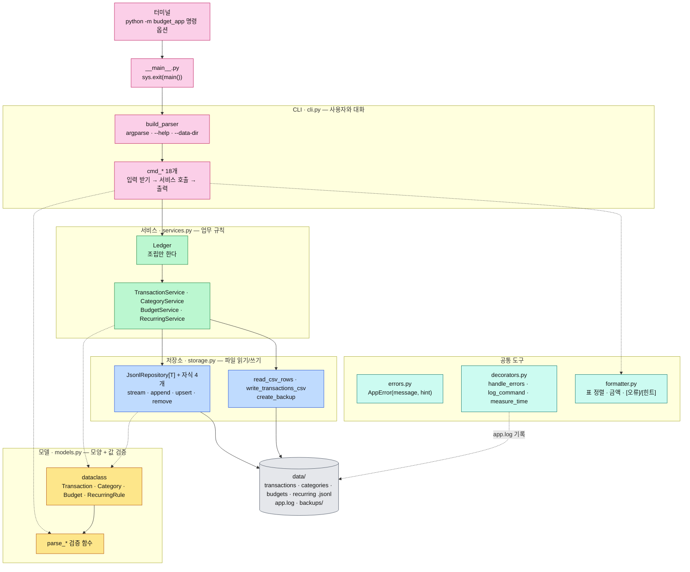

| 계층 | 책임 | 하지 않는 일 | 이 파일을 고치는 때 |
|---|---|---|---|
| CLI `cli.py` | 명령줄 해석(argparse), 입력 받기(`input`), 서비스 호출, 출력 | 규칙 판단, 파일 접근 (`storage` 를 import 하지도 않음) | 명령 · 옵션 · 화면이 바뀔 때 |
| 서비스 `services.py` | 업무 규칙: 등록된 카테고리만, 최신순, 사용 중 카테고리 삭제 막기, export 기간 조건, 요약 계산 | `print` / `input`, JSON · CSV 문법 | 규칙이 바뀔 때 |
| 저장소 `storage.py` | 제너레이터로 읽기, 끝에 추가, 원자적 교체, CSV, 백업 | 규칙 판단 | 저장 형식이 바뀔 때 (JSONL → SQLite) |
| 모델 `models.py` | 데이터 모양(dataclass)과 값 검증(`parse_*`) | 파일, 화면 | 항목이나 검증 규칙이 바뀔 때 |

**말할 것**
- "무엇이 바뀌면 이 파일을 고치는가"로 나눴습니다. 저장 형식을 SQLite 로 바꾸면 `storage.py` 만, 화면을 웹으로 바꾸면 `cli.py` 만 바꾸고 서비스 아래는 그대로 씁니다.
- 의존은 위에서 아래로만 흐릅니다. `cli.py` 는 `storage` 를 import 하지 않고 `Ledger` 의 서비스만 부릅니다.
- 여러 계층이 같이 쓰는 도구가 셋 있습니다. 원인과 힌트를 함께 담는 예외(`errors.py`), 공통 관심사를 떼어 낸 데코레이터(`decorators.py`), 화면 문자열을 만드는 포맷터(`formatter.py`)입니다.

**코드** [budget_app/__init__.py](../budget_app/__init__.py) 계층 설명 · [cli.py](../budget_app/cli.py#L487) `main` · [services.py](../budget_app/services.py#L466) `Ledger`
**시연** `python3 -m unittest tests.test_spec_static.StructureTests -v` — import 방향, "input 은 cli 에만", "파일 열기는 storage 에만"을 소스에서 세어 확인합니다.

---

## 2. Ledger 조립 — 서비스는 저장소를 받는다

> 서비스끼리는 서로를 부르지 않습니다. 다른 데이터가 필요하면 그 데이터의 **저장소**를 직접 받습니다. 누가 어떤 파일을 쓰는지는 `Ledger` 한 곳에서 정합니다.

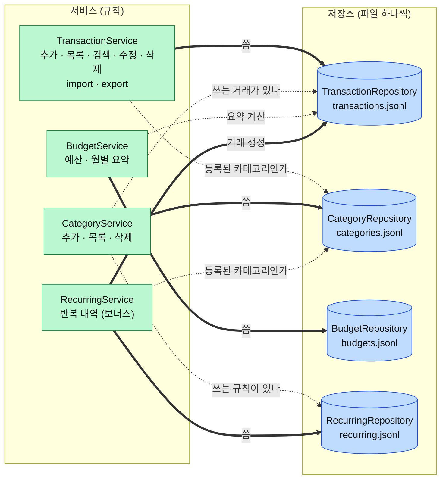

굵은 선은 쓰기, 점선은 읽기만 하는 것입니다.

| 클래스 | 아는 것 | 모르는 것 |
|---|---|---|
| `Transaction` (dataclass) | 필드 7개, 값이 올바른지(`__post_init__`) | 파일, 다른 거래, 등록된 카테고리 목록 |
| `JsonlRepository` 와 자식 4개 | 파일 경로, 한 줄 ↔ 객체 변환, 안전하게 다시 쓰기 | 어떤 거래가 허용되는지 |
| `TransactionService` 등 서비스 4개 | 규칙(등록된 카테고리만, 사용 중이면 삭제 금지, 예산 사용률 ...) | 화면, JSON 문법 |
| `Ledger` | 어떤 서비스가 어떤 파일을 쓰는지 (조립) | 규칙 |

**말할 것**
- 거래 서비스는 "등록된 카테고리인가"를, 카테고리 서비스는 "이 카테고리를 쓰는 거래가 있나"를 알아야 합니다. 서로를 부르게 하면 둘이 맞물려서, 필요한 저장소를 직접 받게 했습니다.
- 저장소 4개는 `JsonlRepository` 하나를 상속하고 `model`(한 줄을 어떤 dataclass 로)과 `key_field`(id / name / month) 두 가지만 다르게 정합니다.
- `summary` 가 `BudgetService` 에 있는 이유: 거래와 예산을 둘 다 읽어야 하고 결과의 핵심이 예산 대비 사용률이라서입니다.

**코드** [Ledger.__init__](../budget_app/services.py#L473) · [CategoryService](../budget_app/services.py#L280) · [JsonlRepository](../budget_app/storage.py#L30) · [TransactionRepository](../budget_app/storage.py#L165)

---

## 3. 명령 한 번의 일생

> 이 프로그램은 명령 하나를 실행하고 끝납니다. 그래서 방금 추가한 거래가 다음 명령에서 보인다는 것 자체가 파일에서 읽어 왔다는 뜻입니다.

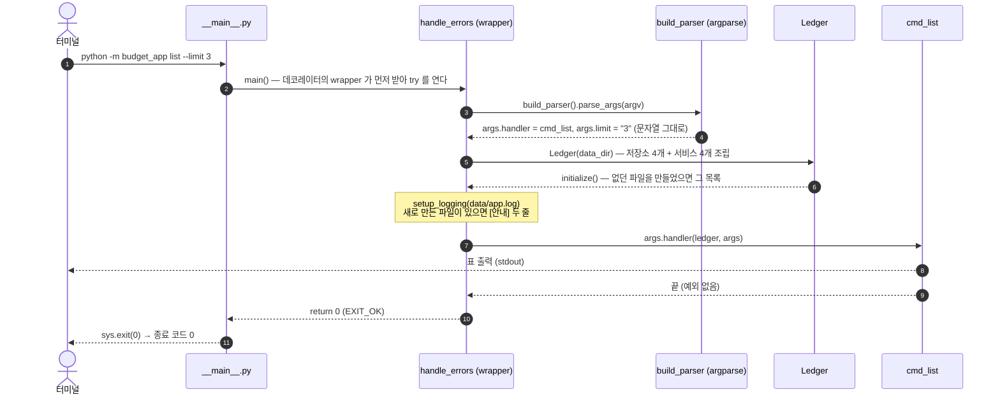

처음 실행하면(저장 폴더가 없으면) 이렇게 나옵니다.

```text
$ python -m budget_app list
[안내] 저장 파일을 새로 만들었습니다: data (transactions.jsonl, categories.jsonl, budgets.jsonl, recurring.jsonl)
[안내] 거래를 추가하려면 먼저 category add 로 카테고리를 등록하세요.
기록된 거래가 없습니다. add 명령으로 추가하세요.
```

명령 형식이 틀리면 argparse 가 명령 함수까지 가지 않고 끝냅니다.

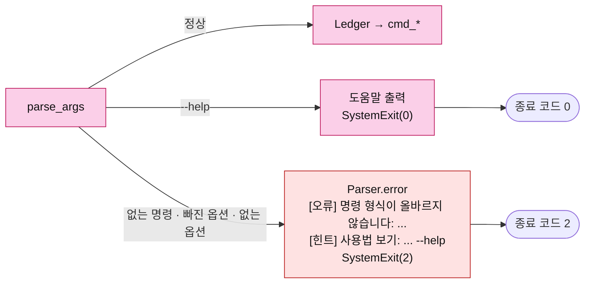

**말할 것**
- `python -m budget_app` 은 `budget_app/__main__.py` 를 실행합니다. 거기서 `main()` 이 돌려준 숫자를 `sys.exit` 에 넘겨 종료 코드로 씁니다.
- argparse 는 옵션 값을 전부 **문자열**로 받습니다(`args.limit == "3"`). 검사는 `models.py` 의 `parse_count` 같은 함수가 해서, 오류가 항상 `[오류]/[힌트]` 한국어로 나옵니다.
- `SystemExit` 는 `Exception` 이 아니라서 `handle_errors` 가 잡지 않고 그대로 나갑니다. 그래서 형식 오류는 2, `--help` 는 0 으로 끝납니다.
- 저장 폴더는 기본 `./data`, `--data-dir 폴더` 로 바꿉니다. `Parser` 가 모든 하위 명령에 이 옵션을 넣어 두어서 명령 앞뒤 어디에 써도 됩니다.

**코드** [__main__.py](../budget_app/__main__.py#L11) · [main](../budget_app/cli.py#L487) · [Parser](../budget_app/cli.py#L277) · [Parser.error](../budget_app/cli.py#L297) · [Ledger.initialize](../budget_app/services.py#L486)
**시연** `rm -rf data` 뒤 `python3 -m budget_app list` → `ls data` → `python3 -m budget_app summary; echo $?` (2)

---

## 4. add — 대화형 입력과 다시 묻기

> 질문에 하나씩 답하는 대화형입니다. 틀리면 이유와 예시를 보여 주고 **같은 질문을 다시** 합니다.

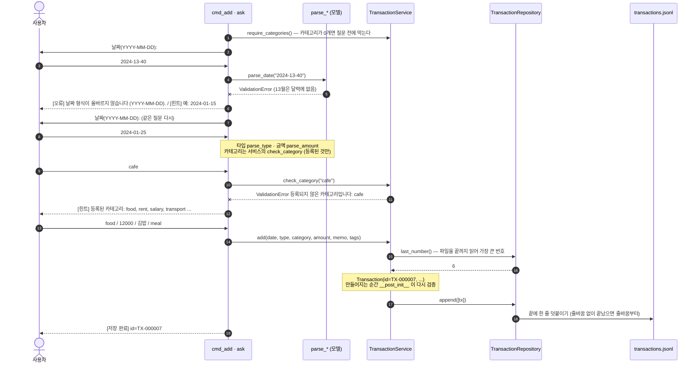

```text
$ python -m budget_app add
날짜(YYYY-MM-DD): 2024-13-40
[오류] 날짜 형식이 올바르지 않습니다 (YYYY-MM-DD).
[힌트] 예: 2024-01-15
날짜(YYYY-MM-DD): 2024-01-25
타입(income/expense): expense
카테고리(food, rent, salary, transport): cafe
[오류] 등록되지 않은 카테고리입니다: cafe
[힌트] 등록된 카테고리: food, rent, salary, transport. 새로 만들려면 category add 를 실행하세요.
카테고리(food, rent, salary, transport): food
금액(양수): 12000
메모(선택): 김밥
태그(쉼표로 구분, 없으면 엔터): meal
[저장 완료] id=TX-000007
```

| 갈래 | 무엇이 보이나 | 종료 코드 |
|---|---|---|
| 값이 틀림 (날짜 · 타입 · 금액 · 카테고리) | `[오류]` + `[힌트]` 뒤 같은 질문 | 계속 |
| 카테고리가 하나도 없음 (명세 4.3 안 B) | 질문 없이 `[오류] 등록된 카테고리가 없어 거래를 추가할 수 없습니다.` | 1 |
| 입력 도중 Ctrl+C · Ctrl+D | `[오류] 실행이 중단되었습니다.` 아무것도 저장 안 됨 | 130 |

**말할 것**
- `ask(질문, 검증 함수)` 하나가 "올바른 값이 올 때까지 되묻기"를 맡습니다. 검증 함수가 `ValidationError` 를 내면 원인과 힌트를 보여 주고 다시 묻습니다.
- 검증 함수는 모델의 `parse_*` 를 그대로 넘깁니다. 카테고리만 서비스의 `check_category` 를 넘기는데, "등록된 것만"은 파일(등록 목록)을 봐야 하는 규칙이라 서비스에 있기 때문입니다.
- 저장은 질문이 다 끝난 뒤 한 번입니다. 그래서 도중에 끊어도 반쯤 저장된 거래가 생기지 않습니다.
- id 는 "가장 큰 번호 + 1" 이라 등록 순서를 알 수 있고 `delete --id` 에 치기 쉽습니다. 대신 이 번호를 찾으려고 파일 전체를 읽습니다(19번 그림).

**코드** [cmd_add](../budget_app/cli.py#L102) · [ask](../budget_app/cli.py#L64) · [parse_date](../budget_app/models.py#L38) · [check_category](../budget_app/services.py#L125) · [TransactionService.add](../budget_app/services.py#L131) · [append](../budget_app/storage.py#L85)
**시연** `python3 -m budget_app add` 에서 날짜에 `2024-13-40`, 카테고리에 `cafe` 를 한 번씩 넣어 다시 묻는 것을 보여 줍니다.

---

## 5. list · search — 읽기 → 거르기 → 고르기

> 저장소는 한 줄씩 흘려보내고, 서비스는 받는 대로 거르고 고릅니다. 파일 전체를 한 번에 올리지 않습니다.

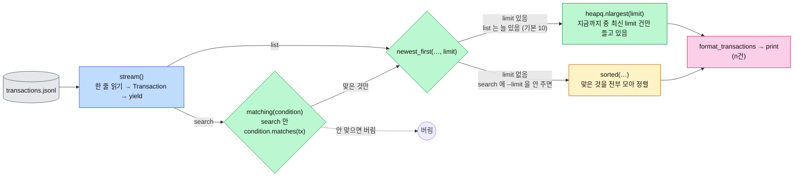

**말할 것**
- "최신순" = 날짜가 늦은 것 먼저, 같은 날이면 나중에 등록한 것(id 번호가 큰 것) 먼저입니다. 그래서 지난 날짜를 나중에 입력해도 날짜 자리에 들어갑니다.
- 전부 모아 정렬하지 않고 `heapq.nlargest` 를 씁니다. 흘러오는 거래를 하나씩 받으며 "지금까지 본 것 중 가장 최신 N건"만 들고 있어서 메모리가 파일 크기가 아니라 `--limit` 에 비례합니다.
- search 는 그 사이에 조건으로 거르는 제너레이터(`matching`)가 하나 더 끼어 있습니다. 읽기 · 거르기 · 고르기가 한 건씩 흐릅니다.
- **주의**: search 에 `--limit` 을 주지 않으면 정렬하려고 맞은 거래를 모두 모읍니다(파일 전체가 아니라 맞은 것만). 정렬은 끝까지 봐야 순서를 알 수 있어서입니다. 10만 건에서 조건이 없으면 64.6MB, `--limit` 을 주면 0.05MB 입니다.

```text
$ python -m budget_app list --limit 3
ID        | 날짜       | 타입    | 카테고리 | 금액     | 메모      | 태그
----------+------------+---------+----------+----------+-----------+----------
TX-000006 | 2024-02-01 | expense | food     |  8,000원 | 커피      | cafe
TX-000007 | 2024-01-25 | expense | food     | 12,000원 | 김밥      | meal
TX-000005 | 2024-01-20 | expense | food     | 30,000원 | 저녁 회식 | meal,team
(3건)

$ python -m budget_app search --category food --tag meal
ID        | 날짜       | 타입    | 카테고리 | 금액     | 메모      | 태그
----------+------------+---------+----------+----------+-----------+----------
TX-000007 | 2024-01-25 | expense | food     | 12,000원 | 김밥      | meal
TX-000005 | 2024-01-20 | expense | food     | 30,000원 | 저녁 회식 | meal,team
TX-000004 | 2024-01-15 | expense | food     | 15,000원 | 점심      | meal
(3건)
```

방금 넣은 TX-000007(1월 25일)이 맨 위가 아니라 두 번째에 옵니다. 등록 순서가 아니라 날짜 순서라서입니다.

**코드** [stream](../budget_app/storage.py#L54) · [matching](../budget_app/services.py#L161) · [newest_first](../budget_app/services.py#L72) · [list_recent](../budget_app/services.py#L157) · [search](../budget_app/services.py#L166) · [DEFAULT_LIMIT](../budget_app/cli.py#L53)

---

## 6. 제너레이터가 한 줄씩 흐르는 모습

> `yield` 가 있는 함수는 불러도 바로 실행되지 않습니다. 값을 달라고 할 때마다 다음 `yield` 까지만 실행하고 멈춥니다.

`list --limit 3` 을 할 때 `heapq.nlargest` 와 `stream()` 이 주고받는 것입니다. 파일에는 7줄이 등록 순서대로 있습니다.

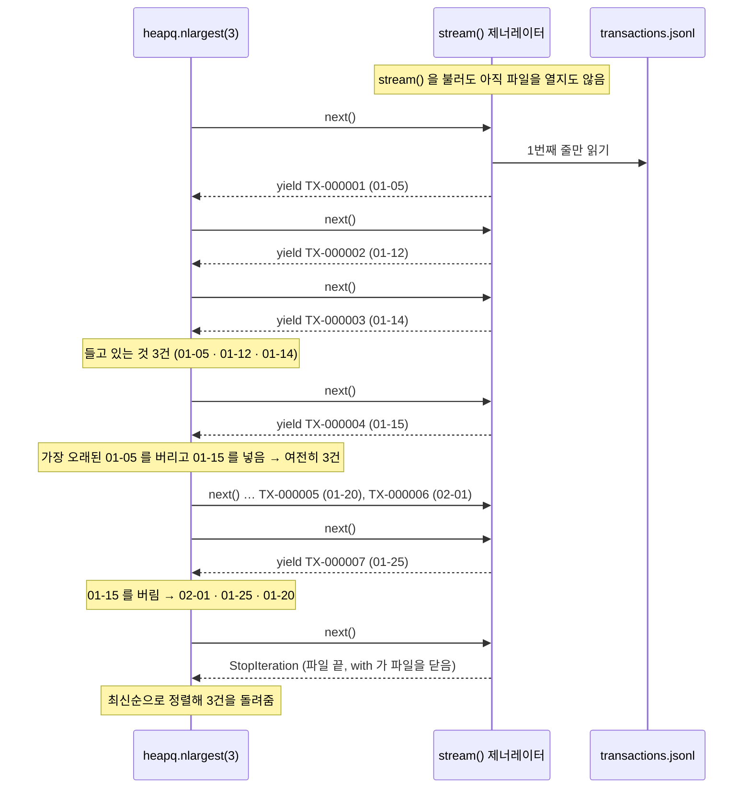

`find` 는 찾는 순간 멈춥니다. `next(제너레이터, None)` 이 첫 번째 것을 받으면 더 달라고 하지 않으니, 그 뒤 줄은 해석하지도 않습니다. 그래서 뒤쪽 줄이 깨져 있어도 앞에서 찾으면 오류가 나지 않습니다(`test_stream_reads_lazily`).

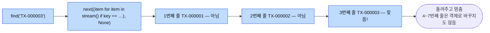

| 방식 (거래 10만 건, 파일 13.7MB) | 최대 메모리 |
|---|---:|
| 전부 list 로 읽기 (비교용) | 55.08 MB |
| `list --limit 10` | 0.05 MB |
| `search` 한 달 + 카테고리 | 0.28 MB |
| `summary` | 0.05 MB |
| `export` 전체 기간 | 0.19 MB |

**말할 것**
- 스트리밍은 **메모리**를 줄이는 것이지 **시간**을 줄이는 것은 아닙니다. 끝까지 읽어야 최신 N건을 알기 때문에 시간(10만 건에서 0.35초)은 그대로입니다.
- `measure_time` 을 `stream` 에 직접 붙이면 0ms 에 가깝게 나옵니다. 제너레이터 함수는 부르자마자 제너레이터 객체만 돌려주고 끝나기 때문입니다. 그래서 끝까지 소비하는 서비스 메서드에 붙였습니다.
- 손상된 줄이 있으면 그 줄에 닿는 순간 `[오류] transactions.jsonl 파일이 손상되었습니다 (7번째 줄).` 로 멈춥니다. 건너뛰면 합계가 조용히 틀리고, 다시 쓸 때 그 줄이 사라지기 때문입니다.

**코드** [stream](../budget_app/storage.py#L54) · [find](../budget_app/storage.py#L76) · [newest_first](../budget_app/services.py#L72) · [measure_time](../budget_app/decorators.py#L110) · [_damaged](../budget_app/storage.py#L158)
**시연** [peer-review.md](peer-review.md) 3-1 의 시연 1 `python3 -c` (제너레이터 객체 → `next` 두 번) · `python3 tests/benchmark.py --records 100000` (약 25초)

---

## 7. search 조건 검사 — SearchFilter.matches

> 거래 한 건이 조건을 위에서부터 차례로 지나갑니다. 준 조건만 검사하고(None 이면 건너뜀), 하나라도 어긋나면 그 자리에서 탈락합니다.

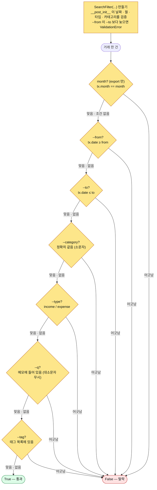

예: `search --from 2024-01-01 --to 2024-01-31 --category food --tag meal`

| 거래 | 어디서 | 결과 |
|---|---|---|
| TX-000004 2024-01-15 food `meal` | 끝까지 | 통과 |
| TX-000006 2024-02-01 food `cafe` | `--to` (2월 1일 > 1월 31일) | 탈락 |
| TX-000003 2024-01-14 salary | `--category` | 탈락 |
| TX-000005 2024-01-20 food `meal,team` | 끝까지 (`meal` 이 목록에 있음) | 통과 |

**말할 것**
- `'YYYY-MM-DD'` 는 자릿수가 고정이라 문자열 비교가 곧 날짜 비교입니다.
- 같은 `SearchFilter` 를 export 도 씁니다. export 는 여기에 "기간 조건이 꼭 있어야 한다"는 규칙(`has_period`)만 더합니다.
- 조건 값 검증은 `SearchFilter` 를 만드는 순간(`__post_init__`) 끝납니다. 그래서 `matches` 는 검증된 값끼리 비교만 합니다.

```text
$ python -m budget_app search --from 2024-02-01 --to 2024-01-01
[오류] 시작일(--from)이 종료일(--to)보다 늦습니다.
[힌트] --from 에 더 이른 날짜를, --to 에 더 늦은 날짜를 넣으세요.
```

**코드** [SearchFilter](../budget_app/models.py#L247) · [__post_init__](../budget_app/models.py#L261) · [matches](../budget_app/models.py#L283) · [cmd_search](../budget_app/cli.py#L127)

---

## 8. summary · budget

> 그 달의 거래를 **한 번 훑으며** 더합니다. 메모리에는 합계와 카테고리별 소계만 남습니다.

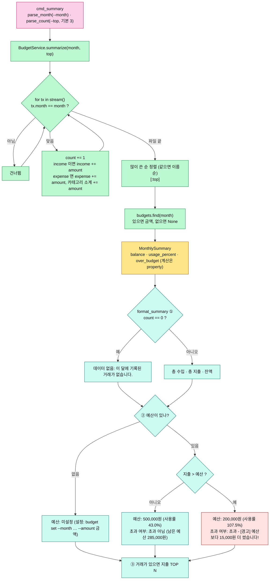

`budget set` 은 `upsert` 라서 같은 달에 다시 하면 줄이 늘지 않고 금액이 바뀝니다.

```text
$ python -m budget_app budget set --month 2024-01 --amount 500000
[저장 완료] 2024-01 예산 500,000원

$ python -m budget_app summary --month 2024-01 --top 3
[2024-01 월별 요약]
총 수입: 3,000,000원
총 지출: 215,000원
잔액: 2,785,000원
예산: 500,000원 (사용률 43.0%)
초과 여부: 초과 아님 (남은 예산 285,000원)

지출 TOP 3
1) rent 150,000원
2) food 45,000원
3) transport 20,000원
```

숫자는 README 예시 데이터(시연 준비 직후, 명세 8장 예시와 같은 값)입니다. 예산을 200,000원으로 바꾸면 `사용률 107.5%`, `초과 - [경고] 예산보다 15,000원 더 썼습니다!` 가 나옵니다.

**말할 것**
- 사용률 = 총 지출 ÷ 예산 × 100, 초과 금액 = max(0, 지출 − 예산). 계산은 `MonthlySummary` 의 property 이고, 서비스는 숫자를 모으기만 하고, 문장은 포맷터가 만듭니다.
- 출력은 세 덩어리를 차례로 붙입니다. ① 거래가 없으면 "데이터 없음", 있으면 수입 · 지출 · 잔액 ② 예산 줄(없으면 설정 방법) ③ 거래가 있으면 지출 TOP N. 그래서 거래가 없는 달도 예산 줄은 나옵니다.
- 금액은 원 단위 정수입니다. 실수(float)는 더할 때 오차가 생길 수 있어서입니다.

**코드** [cmd_summary](../budget_app/cli.py#L142) · [summarize](../budget_app/services.py#L348) · [set_budget](../budget_app/services.py#L337) · [usage_percent](../budget_app/models.py#L318) · [over_budget](../budget_app/models.py#L324) · [format_summary](../budget_app/formatter.py#L88)

---

## 9. update · delete

> `update` 는 옵션 방식으로 고정했습니다(명세 4.6 안 A). `--id` 뒤에 바꿀 항목만 줍니다.

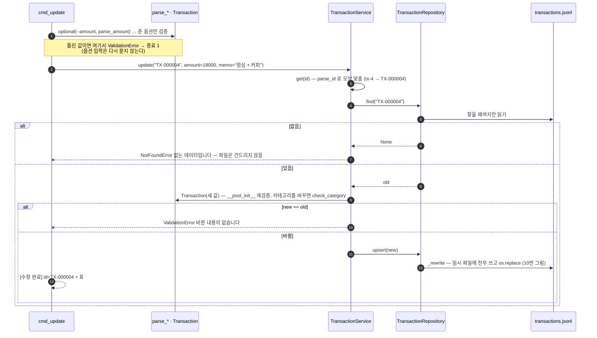

`delete` 는 `get` 으로 있는지 먼저 보고, `remove` 가 그 줄만 빼고 다시 씁니다.

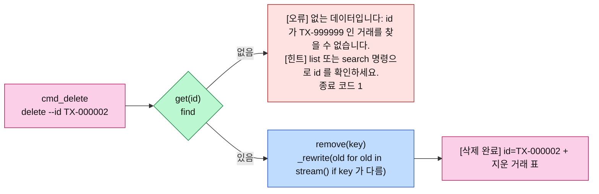

| 갈래 | 출력 (실제) | 종료 코드 |
|---|---|---|
| 성공 | `[수정 완료] id=TX-000004` + 바뀐 거래 표 | 0 |
| 없는 id | `[오류] 없는 데이터입니다: id 가 TX-000099 인 거래를 찾을 수 없습니다.` | 1 |
| 바뀐 내용 없음 | `[오류] 바뀐 내용이 없습니다.` `[힌트] … 예: update --id TX-000004 --amount 20000` | 1 |
| 잘못된 값 `--amount -5` | `[오류] 금액은 0보다 커야 합니다.` | 1 |
| 등록 안 된 카테고리 `--category cafe` | `[오류] 등록되지 않은 카테고리입니다: cafe` | 1 |

**말할 것**
- 없는 id 와 잘못된 값은 파일을 건드리기 **전에** 걸러 냅니다. 쓰기까지 가는 것은 검증을 다 통과한 새 거래뿐입니다.
- 새 값으로 `Transaction` 을 새로 만들어서 `__post_init__` 검증을 다시 통과하게 했습니다. add · import 와 같은 검증입니다.
- `--memo ""`, `--tags ""` 로 메모 · 태그를 지울 수 있습니다. 옵션을 안 준 것(None)과 빈 값을 준 것을 구분합니다.

**코드** [cmd_update](../budget_app/cli.py#L188) · [optional](../budget_app/cli.py#L77) · [get](../budget_app/services.py#L170) · [update](../budget_app/services.py#L183) · [delete](../budget_app/services.py#L213) · [upsert](../budget_app/storage.py#L96) · [remove](../budget_app/storage.py#L113)

---

## 10. 원자적 교체 — _rewrite

> 텍스트 파일은 가운데 한 줄만 고칠 수 없어서 전체를 다시 써야 합니다. 원본에 바로 덮어쓰지 않고 **임시 파일에 다 쓴 뒤 한 번에 바꿔치기**합니다. (보너스 4)

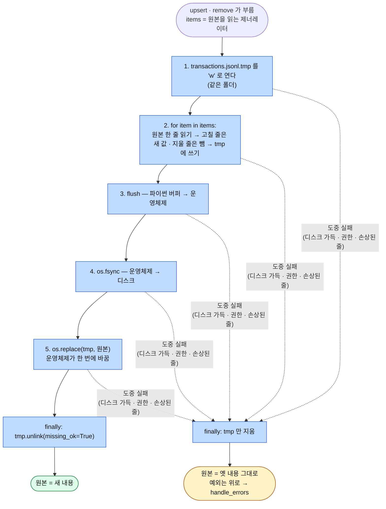

원본에 바로 덮어쓴다면:


쓰기 권한이 없는 폴더에서 `delete` 를 하면 임시 파일을 열다가 실패하고, 원본은 그대로입니다.

```text
$ python -m budget_app delete --id TX-000001
[오류] 파일을 읽거나 쓰지 못했습니다 (data/transactions.jsonl.tmp): Permission denied
[힌트] 경로가 맞는지, 쓰기 권한이 있는지 확인하세요.
```

**말할 것**
- `os.replace` 는 운영체제가 한 번에 처리하는 동작이라, 다른 프로그램은 "옛 파일" 아니면 "새 파일"만 봅니다. 반쯤 쓰인 파일은 볼 수 없습니다.
- `flush` 는 파이썬 → 운영체제, `fsync` 는 운영체제 → 디스크입니다. 바꿔치기 전에 새 내용이 디스크에 있게 합니다.
- 손상된 줄이 있으면 다시 쓰기를 하지 않고 멈춥니다. 건너뛰고 다시 쓰면 그 줄이 영영 사라지기 때문입니다.
- 추가(append)는 끝에 한 줄만 붙이므로 다시 쓰지 않습니다. 대신 파일이 줄바꿈 없이 끝나 있으면 줄바꿈부터 넣어 새 줄이 같이 깨지지 않게 합니다.
- **한계**: 두 터미널에서 동시에 쓰는 것을 막는 잠금은 없습니다. 파일은 깨지지 않지만 한쪽 변경이 사라질 수 있습니다.

**코드** [_rewrite](../budget_app/storage.py#L120) · [upsert](../budget_app/storage.py#L96) · [remove](../budget_app/storage.py#L113) · [_last_line_is_cut](../budget_app/storage.py#L150)
**시연** `python3 -m unittest tests.test_storage.SafeWriteTests -v` — 쓰다가 실패 · 바꿔치기 실패에서 원본이 바이트 단위로 그대로인지 봅니다.

---

## 11. category add · remove

> 추가 · 삭제는 이름을 묻는 대화형, 목록은 가나다순입니다. **쓰고 있는 카테고리는 삭제를 막습니다**(명세 4.10).

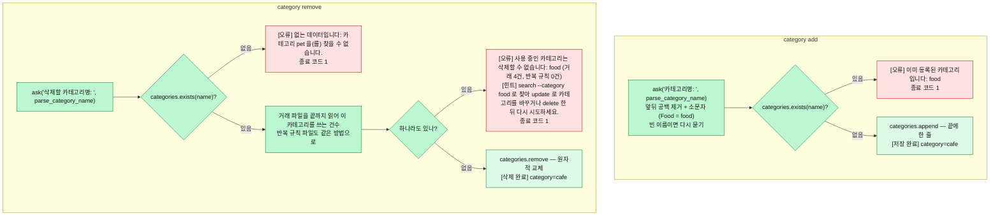

**말할 것**
- 지워 버리면 거래는 남았는데 카테고리는 없는 모순이 생겨서 막았습니다. 막을 때 몇 건이 쓰고 있는지와 어떻게 하면 지울 수 있는지를 알려 줍니다.
- `CategoryService` 가 거래 저장소와 반복 규칙 저장소를 **읽기 전용으로** 받기 때문에 셀 수 있습니다(2번 그림).
- 카테고리가 하나도 없으면 `add` 를 막고 `category add` 를 먼저 하라고 안내합니다(명세 4.3 안 B). 기본 카테고리를 자동으로 만들지 않습니다.

**코드** [CategoryService.add](../budget_app/services.py#L293) · [CategoryService.remove](../budget_app/services.py#L306) · [parse_category_name](../budget_app/models.py#L94) · [cmd_category_remove](../budget_app/cli.py#L181)
**시연** `category add`(cafe) → `category list` → `category remove`(cafe, 지워짐) → `category remove`(food, 막힘) → `echo $?`

---

## 12. import — 검증을 끝낸 뒤 한꺼번에 저장

> **부분 성공 + 보고**입니다. 맞는 행은 넣고, 틀린 행은 건너뛰되 몇 번째 줄이 왜 틀렸는지 하나하나 알려 줍니다. 파일 자체를 못 읽으면 한 건도 넣지 않습니다.

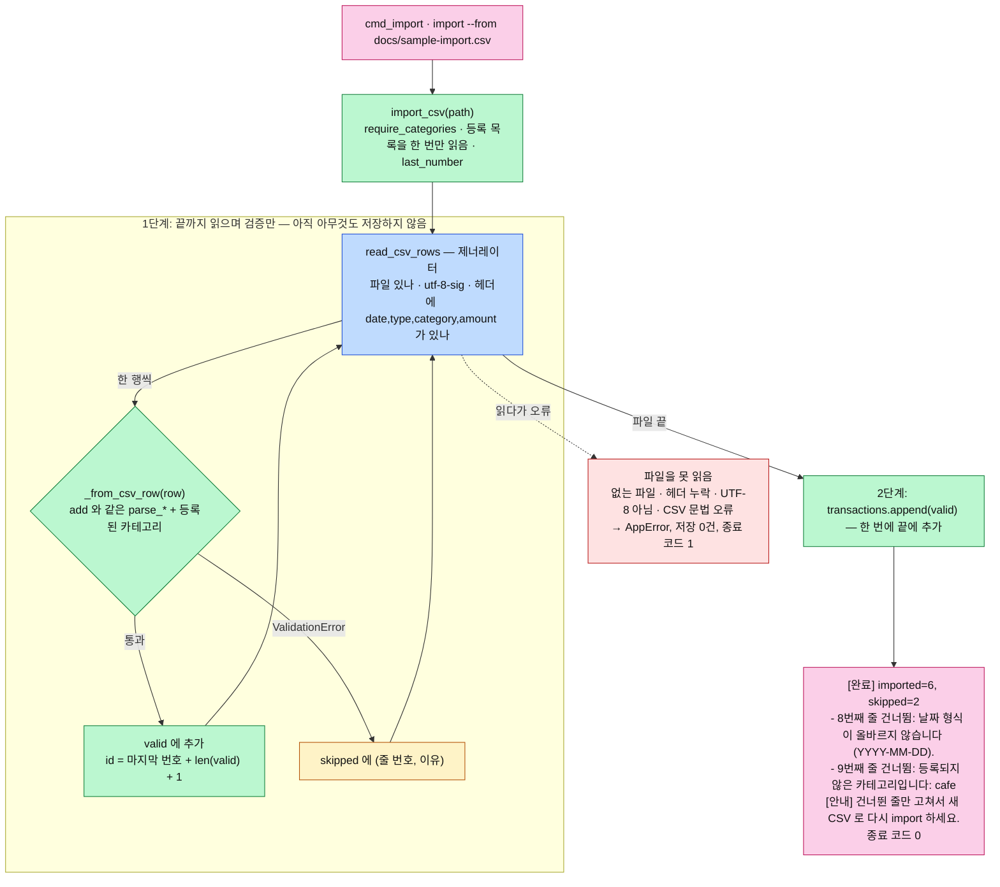

[docs/sample-import.csv](sample-import.csv) — 헤더가 1번째 줄입니다.

| 줄 | 내용 | 결과 |
|---:|---|---|
| 2 ~ 7 | rent 월세 · transport 버스 카드 · salary 월급 · food 점심 · food 저녁 회식 · food 커피 | TX-000001 ~ TX-000006 |
| 8 | `2024-02-30,expense,food,1000,달력에 없는 날짜,` | 건너뜀 — 2월 30일은 달력에 없음 |
| 9 | `2024-02-03,expense,cafe,4500,등록하지 않은 카테고리,` | 건너뜀 — 등록되지 않은 카테고리 |

**말할 것**
- 말없이 건너뛰면 사용자는 다 들어간 줄 압니다. 그래서 **보고**가 핵심입니다.
- 두 단계로 나눠서 "일부만 들어갔는지 아닌지 모르는 상태"가 생기지 않게 했습니다. 읽기 자체가 실패하면 2단계까지 가지 않습니다.
- 행 검증은 `add` 와 같은 `parse_*` 를 씁니다. 대화형 · 옵션 · CSV 의 검증 규칙이 한 곳입니다(15번 그림).
- 롤백(한 줄이라도 틀리면 전부 거부)을 고르지 않은 이유: 명세 예시가 `imported=5, skipped=0` 형태이고, 1,000줄 중 한 줄 때문에 전체를 거부하면 불편합니다. 대신 **파일 단위**의 실패는 전부 취소합니다.
- **남은 약점**: CSV 에 id 가 없어 같은 파일을 다시 넣으면 중복됩니다. 그래서 안내 문구로 "건너뛴 줄만 고쳐서 새 파일로" 넣으라고 알려 줍니다.

**코드** [import_csv](../budget_app/services.py#L222) · [_from_csv_row](../budget_app/services.py#L246) · [read_csv_rows](../budget_app/storage.py#L208) · [cmd_import](../budget_app/cli.py#L211)

---

## 13. export — 기간 조건과 한 건씩 쓰기

> `--month` 또는 `--from` 과 `--to` 가 꼭 있어야 합니다. 정렬이 필요 없어서 읽기 → 거르기 → 쓰기가 처음부터 끝까지 한 건씩 흐릅니다.

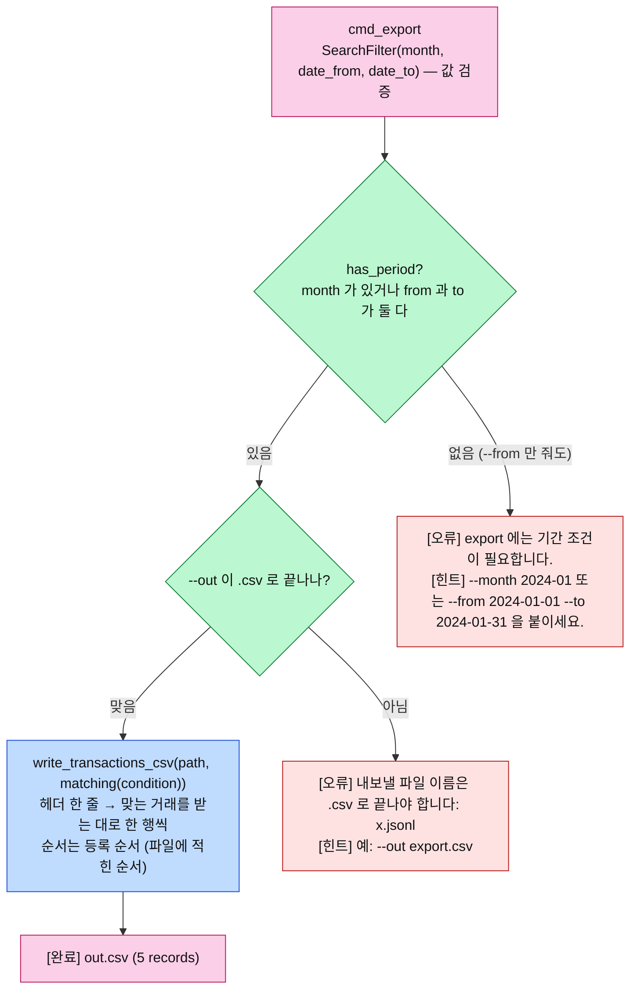

```text
$ python -m budget_app export --out out.csv --month 2024-01
[완료] out.csv (5 records)
$ cat out.csv
date,type,category,amount,memo,tags
2024-01-05,expense,rent,150000,월세,"home,fixed"
2024-01-14,income,salary,3000000,월급,
2024-01-15,expense,food,18000,점심 + 커피,meal
2024-01-20,expense,food,30000,저녁 회식,"meal,team"
2024-01-25,expense,food,12000,김밥,meal
```

**말할 것**
- `.csv` 만 허용하는 이유: 실수로 `--out data/transactions.jsonl` 처럼 저장 파일을 덮어쓰는 일을 막으려고입니다.
- id 는 내보내지 않습니다. 명세의 CSV 스키마(6개 컬럼)를 그대로 지켜서, export 한 파일을 그대로 다시 import 할 수 있습니다.
- 태그가 여러 개면 쉼표가 들어가므로 csv 모듈이 `"home,fixed"` 처럼 따옴표로 감쌉니다.
- 조건에 맞는 거래가 없으면 헤더만 있는 파일이 만들어지고 `(0 records)` 입니다.

**코드** [cmd_export](../budget_app/cli.py#L223) · [export_csv](../budget_app/services.py#L259) · [has_period](../budget_app/models.py#L279) · [write_transactions_csv](../budget_app/storage.py#L239) · [CSV_COLUMNS](../budget_app/storage.py#L204)

---

## 14. JSONL 과 CSV — 같은 거래의 두 모양

> 내부 저장은 JSONL, 외부와 주고받을 때는 CSV 입니다. 역할을 나눴습니다.

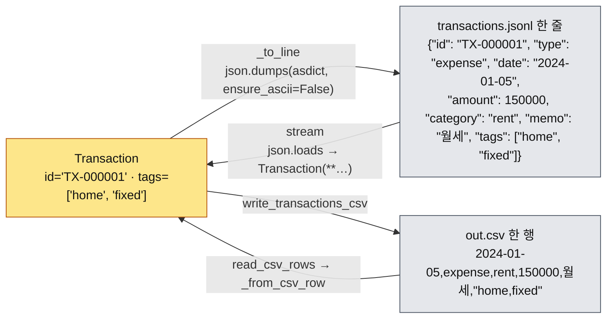

| | JSONL (내부) | CSV (외부) |
|---|---|---|
| 리스트(tags) | 그대로 `["home", "fixed"]` | 한 칸에 넣을 규칙을 따로 정해야 함 `"home,fixed"` |
| 특수문자(쉼표 · 따옴표 · 줄바꿈) | JSON 이 이스케이프 | 따옴표 규칙(RFC 4180)을 지켜야 함 |
| 숫자와 문자 구분 | 됨 (`150000` 과 `"150000"`) | 전부 문자열 |
| 필드 이름 | 줄마다 반복 → 파일이 큼 (10만 건 13.7MB) | 헤더 한 번 → 작음 |
| 엑셀로 열기 | 안 됨 | 됨 |
| 한 줄 추가 · 한 줄씩 읽기 | 쉬움 | 쉬움 |
| 한 줄만 고치기 | 안 됨 → 전체 다시 쓰기 | 안 됨 (같음) |

**말할 것**
- 태그가 리스트이고 메모가 자유 텍스트라는 점이 가장 큰 이유입니다. JSON 은 리스트를 그대로 담고 특수문자를 알아서 이스케이프합니다.
- JSONL 은 한 줄이 기록 하나라서 추가할 때 끝에 한 줄만 붙이면 되고, 한 줄씩 읽는 제너레이터와도 잘 맞습니다.
- 사람이나 엑셀과 주고받을 때는 CSV 가 편해서 import/export 는 CSV 로 했습니다(명세가 CSV 로 고정하기도 함).
- `ensure_ascii=False` 로 한글을 `월` 가 아니라 그대로 저장해서 편집기로 열어도 읽힙니다.

**코드** [_to_line](../budget_app/storage.py#L146) · [stream](../budget_app/storage.py#L54) · [read_csv_rows](../budget_app/storage.py#L208) · [write_transactions_csv](../budget_app/storage.py#L239)
**시연** `cat data/transactions.jsonl` 과 `cat out.csv` 를 나란히 보여 줍니다.

---

## 15. 검증은 한 곳 — parse_* 와 __post_init__

> 값이 들어오는 길은 넷이지만 검증 함수는 하나입니다. 길마다 **틀렸을 때의 처리**만 다릅니다.

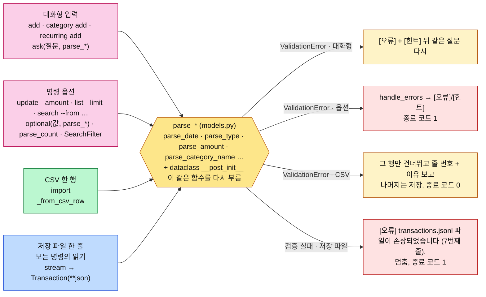

| 검증 함수 | 받는 것 | 막는 것 (실제 문구) |
|---|---|---|
| `parse_date` | `'YYYY-MM-DD'` + 달력에 있는 날 | `2024-13-40`, `20240115`, `2024-02-30` → 날짜 형식이 올바르지 않습니다 (YYYY-MM-DD). |
| `parse_type` | income / expense (대소문자 무시) | 타입은 income 또는 expense 중 하나여야 합니다. |
| `parse_amount` | 양의 정수, `15,000` 쉼표 허용 | 금액은 정수여야 합니다. · 금액은 0보다 커야 합니다. |
| `parse_category_name` | 공백 제거 + 소문자 | 카테고리 이름이 비어 있습니다. |
| `registered_category` (서비스) | 등록된 카테고리 | 등록되지 않은 카테고리입니다: cafe |
| `parse_count` | 1 이상 정수 | --limit 값은 1 이상의 정수여야 합니다. |
| `parse_id` | `TX-000012`, `tx-12` 도 맞춰 줌 | id 형식이 올바르지 않습니다 |

**말할 것**
- 검증 규칙은 모델 한 곳에 있고, 대화형 · 옵션 · CSV 가 같은 함수를 씁니다. 그래서 규칙이 어긋나지 않고 오류 문구가 항상 같은 모양입니다.
- `Transaction` 은 만들어질 때 `__post_init__` 에서 스스로 검증합니다. 파일에서 읽을 때도 거칩니다. 파일은 사람이 편집기로 고칠 수 있어서, 어떤 경로로 만들어지든 잘못된 값을 가진 객체가 프로그램 안을 돌아다니지 않게 했습니다.
- "등록된 카테고리만"은 파일(등록 목록)을 봐야 하는 규칙이라 모델이 아니라 서비스(`registered_category`)에 있습니다.

**코드** [parse_date](../budget_app/models.py#L38) · [Transaction.__post_init__](../budget_app/models.py#L180) · [ask](../budget_app/cli.py#L64) · [optional](../budget_app/cli.py#L77) · [_from_csv_row](../budget_app/services.py#L246) · [stream](../budget_app/storage.py#L54) · [registered_category](../budget_app/services.py#L93)

---

## 16. 데코레이터 세 개가 감싸는 순서

> 명령 함수에는 "무엇을 할지"만 남기고, 어느 명령에나 똑같이 필요한 일(오류 처리 · 실행 기록 · 시간 측정)은 데코레이터가 앞뒤에서 대신합니다.

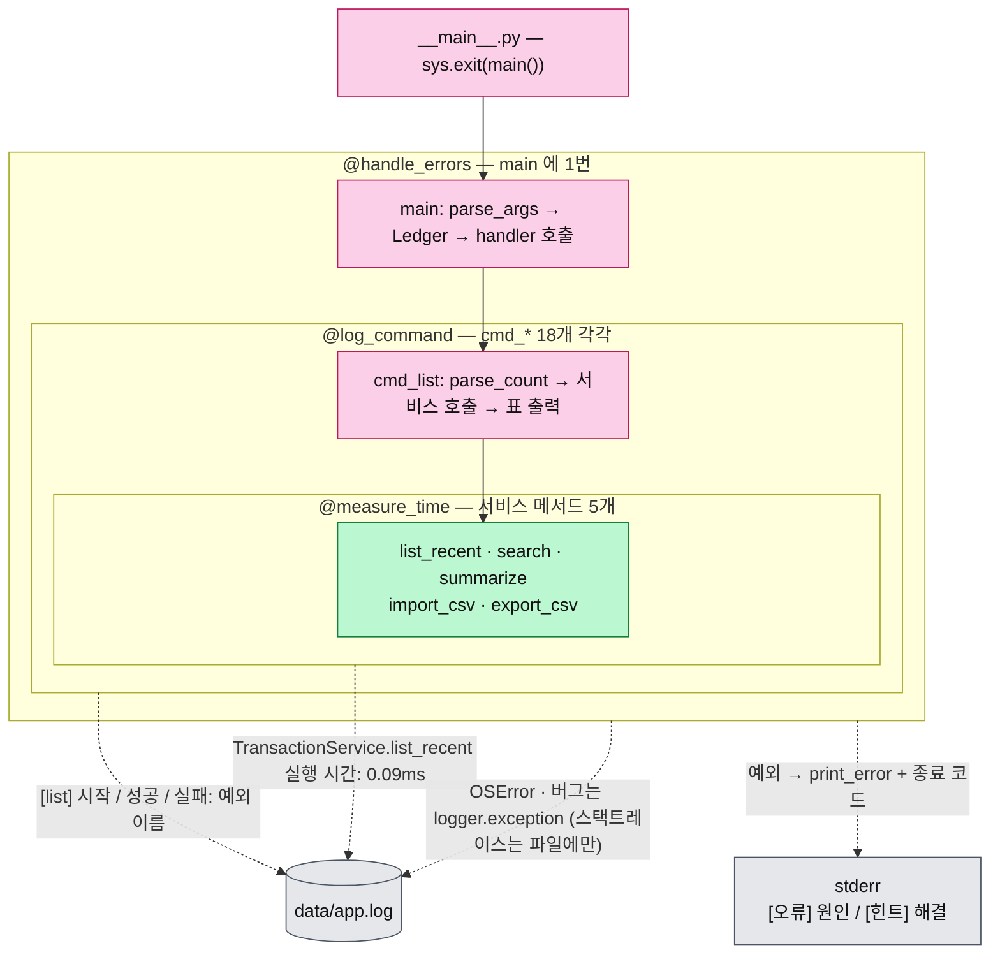

`list` 한 번과 없는 id 의 `delete` 한 번을 했을 때 `data/app.log` 에 남는 줄입니다.

```text
2026-09-30 18:37:25,636 INFO [list] 시작
2026-09-30 18:37:25,636 INFO TransactionService.list_recent 실행 시간: 0.09ms
2026-09-30 18:37:25,636 INFO [list] 성공
2026-09-30 18:37:25,679 INFO [delete] 시작
2026-09-30 18:37:25,679 INFO [delete] 실패: NotFoundError
```

| 데코레이터 | 하는 일 | 붙인 곳 | 한 곳에 몰아 둔 이유 |
|---|---|---|---|
| `handle_errors` | 예외 → `[오류]/[힌트]` + 종료 코드 | `main` 한 곳 | 모든 명령이 `main` 을 거치므로 한 번이면 됨 |
| `log_command` | 시작 · 성공 · 실패를 app.log 에 | `cmd_*` 18개 | 명령 이름(`cmd_list` → `list`)으로 기록. 잡은 예외는 다시 `raise` 해서 처리는 `handle_errors` 에게 |
| `measure_time` | 걸린 시간을 app.log 에 | 파일을 끝까지 읽는 서비스 메서드 5개 | `finally` 라서 실패해도 기록. 제너레이터 함수에 붙이면 0ms 라서 서비스에 |

**말할 것**
- 데코레이터는 함수를 받아 새 함수(`wrapper`)를 돌려주는 함수입니다. `@log_command` 는 `cmd_list = log_command(cmd_list)` 와 같습니다. `wrapper` 는 원래 함수를 기억해 두었다가(클로저) 앞뒤에 일을 덧붙여 부릅니다.
- 데코레이터가 없다면 18개 명령 함수마다 try/except 와 로그 호출이 복사되어 들어가고, 오류 문구 형식을 바꾸려면 18군데를 고쳐야 합니다.
- `*args, **kwargs` 로 받아 그대로 넘겨서 어떤 함수에도 붙일 수 있고, `functools.wraps` 로 이름과 설명글을 원래 함수 것으로 유지합니다(`cmd_list.__name__` → `cmd_list`).
- 로그는 화면에 찍지 않습니다. 스택트레이스 출력 금지(명세 4.13)라서 자세한 내용은 파일로만 갑니다.

**코드** [handle_errors](../budget_app/decorators.py#L52) · [log_command](../budget_app/decorators.py#L92) · [measure_time](../budget_app/decorators.py#L110) · [@handle_errors 붙인 곳](../budget_app/cli.py#L486) · [@measure_time 예](../budget_app/services.py#L156)
**시연** `python3 -m budget_app list` → `python3 -m budget_app delete --id TX-999999` → `tail -5 data/app.log`

---

## 17. 예외 → 출력 → 종료 코드

> 예외 클래스가 원인(`message`)과 힌트(`hint`)를 함께 들고 다니고, `main` 에 붙은 `handle_errors` 가 위에서부터 차례로 맞는 `except` 를 찾습니다.

```mermaid
flowchart TD
  R["명령 실행 (main 안)"]
  OK(["예외 없음 → return 0"])
  SX(["SystemExit — argparse 형식 오류 2 · --help 0<br/>Exception 이 아니라서 handle_errors 를 그냥 지나감"])
  E1{"AppError?<br/>ValidationError · NotFoundError 포함"}
  E2{"KeyboardInterrupt · EOFError?<br/>Ctrl+C · Ctrl+D"}
  E3{"BrokenPipeError?<br/>… | head 처럼 받는 쪽이 먼저 끝남"}
  E4{"OSError?<br/>권한 없음 · 디스크 가득"}
  E5{"Exception?<br/>예상하지 못한 오류 (버그)"}
  X1["print_error(message, hint) → 1"]
  X2["[오류] 실행이 중단되었습니다. → 130"]
  X3["출력을 devnull 로 돌림 → 0"]
  X4["logger.exception + [오류] 파일을 읽거나 쓰지 못했습니다 (…) → 1"]
  X5["logger.exception + [오류] 예상하지 못한 오류가 발생했습니다.<br/>[힌트] 저장 폴더의 app.log 에 … → 1"]
  R --> OK
  R --> SX
  R -->|"예외"| E1
  E1 -->|"예"| X1
  E1 -->|"아니오"| E2
  E2 -->|"예"| X2
  E2 -->|"아니오"| E3
  E3 -->|"예"| X3
  E3 -->|"아니오"| E4
  E4 -->|"예"| X4
  E4 -->|"아니오"| E5
  E5 -->|"예"| X5
  classDef tool fill:#ccfbf1,stroke:#0f766e,color:#111
  classDef ok fill:#dcfce7,stroke:#15803d,color:#111
  classDef bad fill:#fee2e2,stroke:#b91c1c,color:#111
  classDef warn fill:#fef3c7,stroke:#b45309,color:#111
  class E1,E2,E3,E4,E5 tool
  class OK,X3 ok
  class X1,X4,X5 bad
  class SX,X2 warn
```

| 종료 코드 | 언제 | 확인한 명령 |
|---|---|---|
| 0 | 정상 · summary 의 "데이터 없음" · import 에서 일부 줄을 건너뛴 경우 | `python3 -m budget_app list; echo $?` |
| 1 | 없는 id · 잘못된 값 · 사용 중 카테고리 삭제 · 없는 CSV · 손상된 저장 파일 · 쓰기 권한 없음 | `python3 -m budget_app delete --id TX-999999; echo $?` |
| 2 | 명령 형식 오류 (없는 명령 · 빠진 필수 옵션 · 없는 옵션) | `python3 -m budget_app summary; echo $?` |
| 130 | 입력 도중 Ctrl+C · Ctrl+D. 아무것도 저장하지 않음 | `python3 -m budget_app add` 에서 Ctrl+C |

**말할 것**
- `except` 순서가 중요합니다. `BrokenPipeError` 는 `OSError` 의 자식이라 먼저 와야 하고, `AppError` 는 `Exception` 의 자식이라 먼저 와야 합니다.
- 오류는 stderr 로 나갑니다. `2>/dev/null` 을 붙이면 오류 두 줄만 사라지고 정상 출력과 섞이지 않습니다.
- 버그는 화면에 "예상하지 못한 오류가 발생했습니다" 만 보여 주고, 스택트레이스는 `data/app.log` 에만 남깁니다.
- **주의**: 명령 형식 오류의 원인 부분은 argparse 의 영어가 그대로 나옵니다(`the following arguments are required: --id`). 모양(`[오류]/[힌트]`)과 종료 코드 2 는 맞췄고 번역까지는 하지 않았습니다.

**코드** [errors.py](../budget_app/errors.py#L11) · [handle_errors](../budget_app/decorators.py#L52) · [EXIT_OK ~ EXIT_CANCELLED](../budget_app/decorators.py#L27) · [print_error](../budget_app/formatter.py#L17) · [Parser.error](../budget_app/cli.py#L297)

---

## 18. 타입 힌트 — 약속과 검사기가 잡은 것

> 타입 힌트는 실행 결과를 바꾸지 않습니다. 함수가 무엇을 받고 무엇을 돌려주는지 **약속**을 적어 두면, 검사기(mypy)가 약속을 어긴 코드를 **실행하기 전에** 찾아 줍니다.

```mermaid
flowchart LR
  subgraph BEFORE["실행 전 — 내 코드끼리의 약속"]
    H["타입 힌트<br/>find → T | None · Literal · ParamSpec · Generic[T]"]
    MY["mypy --strict<br/>Success: no issues found in 9 source files"]
    H --> MY
  end
  subgraph DURING["실행 중 — 밖에서 온 값에 대한 방어"]
    IN["사용자 입력 · 옵션 · CSV · 파일"]
    V["parse_* · __post_init__"]
    IN --> V
  end
  classDef tool fill:#ccfbf1,stroke:#0f766e,color:#111
  classDef model fill:#fde68a,stroke:#b45309,color:#111
  class H,MY tool
  class IN,V model
```

[docs/type_demo.py](type_demo.py) 에 약속을 일부러 어긴 코드를 모아 두었습니다. `uvx mypy docs/type_demo.py` 가 실행하지 않고 다섯 군데를 찾아냅니다.

| 줄 | 어긴 코드 | 검사기가 알려 준 것 | 어느 약속 덕분인가 |
|---:|---|---|---|
| 29 | `print(found.amount)` (find 결과를 바로 씀) | `Item "None" of "Transaction \| None" has no attribute "amount"` | `find(...) -> T \| None` |
| 32 | `Transaction(type="spend", ...)` | `expected "Literal['income', 'expense']"` | `TransactionType = Literal[...]` |
| 36 · 37 | `list_recent("10")` | 데코레이터가 붙어도 `def (limit: int) -> list[Transaction]` 로 보이고, `"str"` 을 잡음 | `ParamSpec` |
| 40 ~ 42 | `ask(…, parse_amount)` 등 | `int` · `str` · `Literal['income'] \| Literal['expense']` | `ask(prompt, parse: Callable[[str], T]) -> T` |
| 45 | `add(…, "15000")` | `incompatible type "str"; expected "int"` | `amount: int` |
| 50 · 51 | `tx.amout` | `"Transaction" has no attribute "amout"; maybe "amount"?` | `Generic[T]` · dataclass 필드 |

**말할 것**
- 첫째, `find` 가 `T | None` 이라서 못 찾았을 때의 처리를 빼먹을 수 없습니다. `get` 의 `if tx is None:` 을 지우면 mypy 가 `Incompatible return value type (got "Transaction | None", expected "Transaction")` 를 냅니다.
- 둘째, 거래 타입을 `Literal["income", "expense"]` 로 적어서 아무 문자열이 들어가는 것을 막았습니다.
- 셋째, 데코레이터에 `ParamSpec` 을 써서 `@measure_time` 을 붙인 뒤에도 원래 매개변수와 반환 타입이 유지됩니다. `Callable[..., Any]` 로 적었다면 `list_recent("10")` 이 검사를 그냥 통과합니다.
- 파이썬은 실행 중에 타입 힌트를 검사하지 않습니다. 그래서 밖에서 오는 값은 `parse_*` 와 `__post_init__` 으로 따로 검증합니다. 타입 힌트는 "내 코드끼리의 약속", 검증은 "밖에서 온 값에 대한 방어"입니다.

**코드** [find](../budget_app/storage.py#L76) · [get](../budget_app/services.py#L170) · [TransactionType](../budget_app/models.py#L24) · [ParamSpec P](../budget_app/decorators.py#L24) · [ask](../budget_app/cli.py#L64) · [JsonlRepository(Generic[T])](../budget_app/storage.py#L30)
**시연** `uvx mypy budget_app --strict` → `uvx mypy docs/type_demo.py`

---

## 19. 10만 건이면 — 병목과 개선

> 메모리는 문제가 없습니다(스트리밍). 병목은 **시간**입니다. 인덱스가 없어서 모든 조회가 파일을 처음부터 끝까지 읽습니다.

`python3 tests/benchmark.py --records 100000` 으로 이 맥에서 잰 대략적인 값입니다.

| 기능 | 1만 건 | 10만 건 | 최대 메모리 (10만 건) | 이유 |
|---|---:|---:|---:|---|
| `list --limit 10` | 35 ms | 355 ms | 0.05 MB | 끝까지 읽어야 최신 10건을 앎 |
| `search` 한 달 + 카테고리 | 37 ms | 337 ms | 0.28 MB | 〃 |
| `summary` | 36 ms | 353 ms | 0.05 MB | 〃 |
| `add` 1건 | 42 ms | 354 ms | 0.05 MB | id 를 만들려고 전체를 읽음 |
| `update` 1건 | 132 ms | 1,242 ms | 0.06 MB | 찾기 + 파일 전체 다시 쓰기 |
| `delete` 1건 | 122 ms | 1,310 ms | 0.06 MB | 〃 |
| `search` 조건 없음, 전부 | 46 ms | 548 ms | 64.60 MB | 정렬하려고 다 모음 |
| (비교) 전부 list 로 읽기 | 36 ms | 389 ms | 55.08 MB | |

```mermaid
flowchart LR
  B1["add 가 전체를 읽음<br/>last_number"] --> F1["마지막 번호를 작은 파일에 따로 저장"]
  B2["모든 조회가 전체를 읽음"] --> F2["월별 파일로 나눔<br/>summary · 기간 검색은 그 달만"]
  B3["수정 · 삭제가 전체를 다시 씀<br/>_rewrite"] --> F3["월별 파일이면 그 달만 다시 씀<br/>또는 '삭제 표시' 줄을 덧붙이고 가끔 정리"]
  B4["id 로 찾기가 O(n)<br/>find"] --> F4["id → 파일 위치 인덱스"]
  B5["search 전부 보기의 메모리<br/>newest_first 가 모음"] --> F5["기본 --limit · 쪽(page) 단위"]
  F1 & F2 & F3 & F4 --> S["저장소 계층만 고침<br/>더 필요하면 sqlite3 (표준 라이브러리)"]
  F5 --> S2["서비스 · CLI"]
  classDef bad fill:#fee2e2,stroke:#b91c1c,color:#111
  classDef repo fill:#bfdbfe,stroke:#1d4ed8,color:#111
  classDef svc fill:#bbf7d0,stroke:#15803d,color:#111
  class B1,B2,B3,B4,B5 bad
  class F1,F2,F3,F4,S repo
  class F5,S2 svc
```

**말할 것**
- 건수가 10배가 되면 시간도 10배가 됩니다(전부 O(n)). 읽는 시간의 대부분은 줄마다 JSON 을 해석하고 검증하는 데 듭니다.
- 개선은 저장소 계층만 바꾸면 되는 것부터 하겠습니다. 계층을 나눠 둔 덕분에 서비스와 CLI 는 그대로 둘 수 있습니다.
- 한마디로 지금 구조는 "개인 가계부 몇 천 건"에는 충분하고(1만 건에서 35ms), 10만 건부터는 수정 · 삭제가 1초를 넘습니다.

**코드** [tests/benchmark.py](../tests/benchmark.py) · [last_number](../budget_app/storage.py#L171) · [_rewrite](../budget_app/storage.py#L120) · [find](../budget_app/storage.py#L76) · [newest_first](../budget_app/services.py#L72)

---

## 20. 보너스 — 반복 내역 · 백업 · 표 정렬

> 보너스 4개를 모두 했습니다. 원자적 교체(보너스 4)는 10번 그림입니다.

**반복 내역** — `recurring apply --month 2024-02`

```mermaid
sequenceDiagram
  autonumber
  participant C as cmd_recurring_apply
  participant S as RecurringService.apply
  participant RR as recurring.jsonl
  participant TR as transactions.jsonl
  C->>S: apply("2024-02")
  S->>TR: last_number() → 7
  S->>RR: stream() — 규칙을 한 줄씩
  RR-->>S: RC-000001 매월 31일 rent 500,000 · applied_months []
  Note over S: 2024-02 가 applied_months 에 없음 → 만든다<br/>date_in: min("2024-02-31", 말일 "2024-02-29") → 2024-02-29
  S->>TR: append(created) — 거래 먼저 저장
  S->>RR: upsert(규칙, applied_months=["2024-02"]) — 그다음 "만들었다" 표시
  C-->>C: [완료] 2024-02 반복 내역 1건 생성 + TX-000008 표
  Note over C,TR: 같은 달에 다시 apply → applied_months 에 있어서 0건
```

- 거래를 먼저 저장하고 표시를 나중에 합니다. 반대 순서면 중간에 꺼졌을 때 "표시만 있고 거래는 없는" 상태가 됩니다. 조용히 사라지는 쪽이 더 나쁩니다. 대신 지금 순서에서는 그 사이에 꺼지면 다음 `apply` 에서 한 번 더 만들어질 수 있습니다(README "알려진 한계").
- 31일 규칙은 날짜 문자열 비교 `min("2024-02-31", "2024-02-29")` 로 말일에 맞춥니다.

**백업** — `backup` 은 저장 파일 4개를 `data/backups/backup-20261018-003312.zip` 하나로 묶습니다. 같은 초에 두 번 실행하면 `-2` 를 붙여 덮어쓰지 않습니다. 되돌리려면 zip 을 풀어 `data` 에 덮어씁니다.

**표 정렬** — 외부 라이브러리 없이 칸을 맞추려면 글자 수가 아니라 **화면 폭**을 알아야 합니다. `len("점심") == 2` 지만 화면에서는 4칸입니다.

```mermaid
flowchart LR
  T["'저녁 회식'"] --> W["display_width<br/>unicodedata.east_asian_width<br/>W · F (넓은 글자) → 2칸, 나머지 → 1칸"]
  W --> N["2+2+1+2+2 = 9칸<br/>(len 은 5)"]
  N --> P["_pad: 열 폭 − 9 만큼 공백"]
  P --> R["render_table — 모든 칸이 같은 폭"]
  classDef tool fill:#ccfbf1,stroke:#0f766e,color:#111
  class T,W,N,P,R tool
```

**코드** [RecurringService.apply](../budget_app/services.py#L428) · [date_in](../budget_app/models.py#L236) · [create_backup](../budget_app/storage.py#L256) · [display_width](../budget_app/formatter.py#L29) · [render_table](../budget_app/formatter.py#L40)

---

## 21. 시연 동선 ↔ 그림

[peer-review.md](peer-review.md) 의 순서대로 시연하면서 옆에 띄울 그림입니다.

| 순서 | 시연 | 그림 |
|---|---|---|
| 0 | `rm -rf data` → `category add` ×4 → `import --from docs/sample-import.csv` | [3](#3-명령-한-번의-일생) · [11](#11-category-add--remove) · [12](#12-import--검증을-끝낸-뒤-한꺼번에-저장) |
| 1-1 | `add`(날짜 한 번 틀리기) → `list --limit 3` → `search` → `summary` → `update` → `delete` → `export` | [4](#4-add--대화형-입력과-다시-묻기) · [5](#5-list--search--읽기--거르기--고르기) · [7](#7-search-조건-검사--searchfiltermatches) · [9](#9-update--delete) |
| 1-2 | `ls data` · `cat data/*.jsonl` · 다시 `list` | [2](#2-ledger-조립--서비스는-저장소를-받는다) · [14](#14-jsonl-과-csv--같은-거래의-두-모양) |
| 1-3 | `category remove`(cafe → 지워짐, food → 막힘) | [11](#11-category-add--remove) |
| 1-4 | `budget set` 500,000 → `summary` → 200,000 → `summary` | [8](#8-summary--budget) |
| 1-5 | `export --month` · 조건 없는 export | [13](#13-export--기간-조건과-한-건씩-쓰기) |
| 1-6 · 1-7 | 틀린 날짜 · 없는 id · 없는 CSV · 깨진 줄 · `echo $?` | [15](#15-검증은-한-곳--parse_-와-__post_init__) · [17](#17-예외--출력--종료-코드) |
| 2-1 · 2-2 | 파일 맨 위 설명글 · `tests.test_spec_static.StructureTests` | [1](#1-전체-구조--네-계층과-공통-도구) · [2](#2-ledger-조립--서비스는-저장소를-받는다) |
| 2-3 | `tests.test_storage.SafeWriteTests` | [10](#10-원자적-교체--_rewrite) |
| 3-1 | `python3 -c` 로 `next` 두 번 · `tests/benchmark.py` | [6](#6-제너레이터가-한-줄씩-흐르는-모습) |
| 3-2 | `tail -5 data/app.log` · `cmd_list.__name__` | [16](#16-데코레이터-세-개가-감싸는-순서) |
| 3-3 | `uvx mypy budget_app --strict` · `uvx mypy docs/type_demo.py` | [18](#18-타입-힌트--약속과-검사기가-잡은-것) |
| 4-1 ~ 4-3 | 말로 답하고 표를 보여 줌 | [14](#14-jsonl-과-csv--같은-거래의-두-모양) · [19](#19-10만-건이면--병목과-개선) · [12](#12-import--검증을-끝낸-뒤-한꺼번에-저장) |
